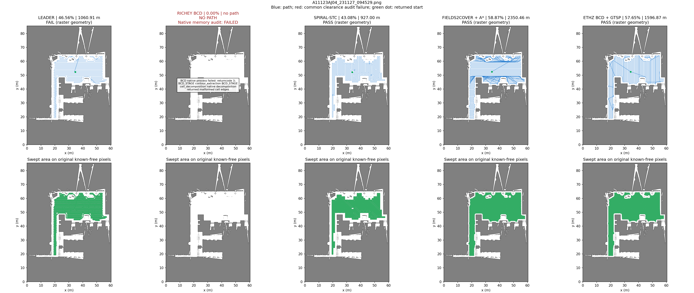

# BG1 Gazebo navigation and coverage

基于 **ROS 2 Jazzy / Gazebo Harmonic** 的 BG1 Pro 轻量仿真与覆盖规划对比项目。
包含差速机器人模型、Nav2/RPP 点到点导航、SLAM 建图、Leader 与 opennav/Fields2Cover
两套独立覆盖演示，以及面向 PNG/PGM 地图的五算法离线 benchmark。

- **[五算法同图对比：三张地图、15 组指标与全局轨迹](docs/benchmarks/five-planners-2026-10-29/README.md)**
- [离线评测模块与复现步骤](coverage_benchmark/README.md)
- [导航、建图和底层构建](ros_ws/README.md)
- [Leader ROS 2 适配、选区与执行](leader_coverage_ws/README.md)
- [opennav/Fields2Cover 覆盖演示](coverage_ws/README.md)
- [Leader 与 Fields2Cover 流程图解、Headland 示意](docs/diagrams/coverage_logic_2026-10-29/README.md)

## Clone

使用子模块固定第三方版本，首次下载：

```bash
git clone --recurse-submodules https://github.com/hellow-space/BG1_Gazebo.git
cd BG1_Gazebo
```

已经下载主仓库时，在根目录初始化依赖：

```bash
git submodule update --init --recursive
```

五个子模块分别为 opennav_coverage、Fields2Cover、Richey BCD、PythonRobotics 和 ETHZ
polygon_coverage_planning；实际版本以主仓库记录的提交为准，来源见 [第三方清单](third_party/README.md)。
Leader 原始 ROS 1 源码直接保存在主仓库中。先按 [底层说明](ros_ws/README.md) 构建，
再按需构建覆盖 overlay：

```bash
bash coverage_ws/build.sh
# 或：bash leader_coverage_ws/build.sh
```

离线评测的依赖和各算法入口见 [评测模块说明](coverage_benchmark/README.md)；克隆仓库不会自动运行评测。

## Run

从仓库根目录启动，每次只运行一个仿真会话：

```bash
# Point-to-point Nav2 navigation
bash ros_ws/navigation_demo.sh

# Independent coverage demo
bash coverage_ws/run.sh
```

在另一终端请求 Fields2Cover 演示规划或执行：

```bash
bash coverage_ws/task.sh             # Plan and visualize only
bash coverage_ws/task.sh --execute   # Approach and follow the coverage path
bash coverage_ws/stop.sh             # Stop coverage Gazebo/RViz and nodes
```

该 Fields2Cover 演示采用仿真真值定位，用于检查规划与路径跟踪；已有
[规划和执行记录](coverage_ws/docs/verification/summary.json) 不代表真机定位或复杂障碍环境全区覆盖能力。
默认任务只规划和显示，运动由明确的执行入口触发。`build/install/log` 为本地生成目录，不入 Git。

## 大场景建图与导航

新增两个可切换场景，详见 [场景说明与 Gazebo 截图](ros_ws/src/bg1_scenarios/README.md)：

| 场景 | 尺寸 | 内容 |
| --- | --- | --- |
| `warehouse` | 36 × 28 m | 货架通道、托盘、立柱 |
| `office` | 32 × 26 m | 16 间互通房间、十字走廊、桌柜 |

```bash
# 选择一个场景建图，打开 Gazebo、RViz 和遥控终端
bash ros_ws/mapping.sh scene:=warehouse
# 或：bash ros_ws/mapping.sh scene:=office

# 保存地图、关闭建图会话
bash ros_ws/save_map.sh
bash ros_ws/stop_mapping.sh

# 使用场景自带参考地图导航（另起会话）
bash ros_ws/navigation_demo.sh scene:=office
# 或：bash ros_ws/navigation_demo.sh scene:=warehouse
```

不传 `scene` 时保留原始 `demo`。每次只运行一个仿真会话。

## Leader 提供的覆盖规划器

`third_party/leader/coverage_path_planner/` 是 leader 提供的 ROS 1 代码，原文件保留。
新增的 [独立 ROS 2 适配与选区说明](leader_coverage_ws/README.md) 与上述
Fields2Cover 覆盖演示分别构建、分别启动：

```bash
bash leader_coverage_ws/build.sh
bash leader_coverage_ws/run.sh
# 在另一个终端先生成一个仓库示例区域
bash leader_coverage_ws/region.sh demo
```

自选区域：RViz **Publish Point** 顺序点顶点，最后点回首个绿色顶点闭合规划。
选好区域后，运行 `bash leader_coverage_ws/motion.sh start` 手动开始运动；
Ctrl+C 或 `bash leader_coverage_ws/motion.sh stop` 取消并停车。

## 项目目录

```text
BG1_Gazebo/
├── docs/                     # 用户手册、设计、流程图解和评测报告
│   ├── benchmarks/           # 三/四/五算法对比及原始规划证据
│   └── diagrams/             # Leader / Fields2Cover 流程图解
├── data/maps/                # 本地地图数据，见该目录 README
│   ├── imported/<地图编号>/   # 导入 PGM/PNG（默认不提交）
│   └── slam/<会话编号>/       # 建图四件套（默认不提交）
├── third_party/              # 原始第三方代码
│   ├── leader/coverage_path_planner/
│   ├── opennav_coverage/      # Git 子模块
│   ├── Fields2Cover/          # Git 子模块
│   ├── bcd_planner/           # Richey BCD 子模块
│   ├── python_robotics/       # 含 Spiral-STC 的子模块
│   └── polygon_coverage_planning/ # ETHZ 子模块
├── coverage_benchmark/       # 自有适配、统一指标、绘图与证据复核
├── ros_ws/                   # BG1 模型、Gazebo、Nav2、SLAM、场景
├── leader_coverage_ws/        # Leader 算法的 ROS 2 适配与执行
└── coverage_ws/               # opennav/Fields2Cover 的 BG1 集成
```

[用户手册](docs/manuals/BG1_Pro_User_Manual_用户手册-CN_0506.pdf)、
[地图数据规则](data/maps/README.md)、[第三方来源](third_party/README.md)。
工作区中的 `build/install/log` 是本地生成内容，不纳入 Git；仿真场景自带的地图仍随 ROS 包提交。

## 覆盖算法离线 benchmark

[五算法统一报告](docs/benchmarks/five-planners-2026-10-29/README.md) 是当前对比入口：
同三张 PNG 地图，保留15组完整轨迹、失败记录、三项指标和五列对照图。
输入适配支持 PNG/PGM；本轮实测使用 PNG。该模块只规划，不启动 Gazebo 或机器人运动。

| 对比实现 | 核心流程 | 本项目适配入口 |
| --- | --- | --- |
| Leader | 粗栅格启发式覆盖遍历、A*连接与轨迹处理 | `coverage_benchmark/adapters/leader.py` |
| Richey BCD | 牛耕式单元分解与往复扫描 | `coverage_benchmark/adapters/bcd.py` |
| PythonRobotics Spiral-STC | 生成树与四子格覆盖遍历 | `coverage_benchmark/adapters/stc.py` |
| Fields2Cover＋净空条带＋A* | 原生有序条带、净空裁剪与避障连接 | `coverage_benchmark/adapters/f2c_safe.py` |
| ETHZ Polygon Coverage | 原生BCD、最佳方向扫描、可见图与GK-MA排序 | `coverage_benchmark/adapters/ethz.py` |

统一报告使用 **覆盖率、完整路径长度、栅格几何有效性** 三项指标，作业宽度0.6 m、中心净空1 m。
覆盖率以原图全部已知自由像素为分母；有效性检查完整路线上的障碍、净空和越界。
各实现的内部规划范围与起终点约束有差异，不能只凭更短路径判断优劣。



ETHZ 本次采用0.2 m保守多边形栅格，每块原像素必须全部满足净空；可能舍弃窄通道和区域，最终仍按原图分辨率审计。
Leader 有少量严格净空不合格段，Richey BCD 有已确认原生内存缺陷；失败和限制均保留在报告中。
栅格几何通过不代表全图覆盖、曲率/动力学可执行或真机能力。

准备本地地图和依赖后，可重跑 ETHZ 并与其余四种已保存路线统一对比：

```bash
python3 -m coverage_benchmark.adapters.ethz_build
python3 -m coverage_benchmark.ethz_compare --output docs/benchmarks/five-planners-local
python3 -m coverage_benchmark.verify_ethz --output docs/benchmarks/five-planners-local
```

导入地图默认不随 Git 提交，需单独准备 `data/maps/imported/<场景>/<场景>.png`。
完整依赖、地图清单、各算法重跑入口与指纹复核见 [模块说明](coverage_benchmark/README.md)。
已有完整实验保存在以下入口：

- [Leader / BCD / STC 三图对比](docs/benchmarks/three-planners-2026-10-27/README.md)
- [Fields2Cover 原生与避障修改版对照](docs/benchmarks/f2c-obstacle-2026-10-28/README.md)
- [四算法统一对比](docs/benchmarks/four-planners-2026-10-28/README.md)
- [五算法统一对比与 ETHZ 适配诊断](docs/benchmarks/five-planners-2026-10-29/README.md)
