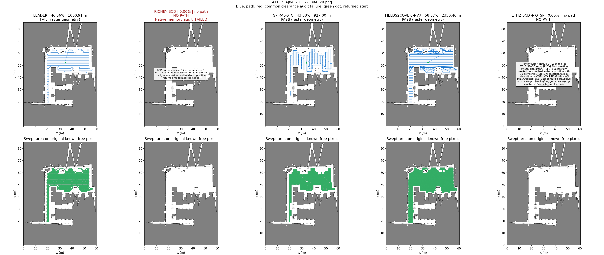
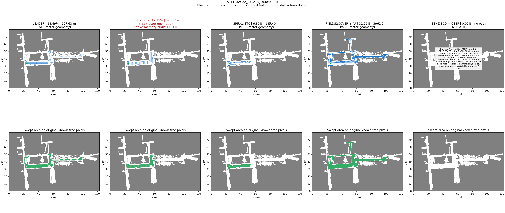
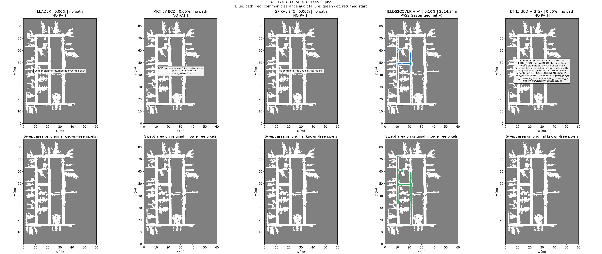

# 五算法同图对比：新增 ETHZ Polygon Coverage Planning

2026-10-29。ETHZ 在相同三张PNG上实际运行；另外四种实现复用已有完整路线，并用同一指标重新核算。本次只规划，不启动Gazebo或运动。

## 三项指标

| 场景 | 算法／完整路线 | 覆盖率 | 路径长度 | 栅格几何有效性 |
| --- | --- | ---: | ---: | --- |
| AJ04 | [Leader](../three-planners-2026-10-27/A11123AJ04_231127_094529_leader.json) | 46.56% | 1,060.91 m | 未通过 |
| AJ04 | [Richey BCD](../three-planners-2026-10-27/A11123AJ04_231127_094529_bcd.json) | 0.00% | —（无路径） | 失败 |
| AJ04 | [Spiral-STC](../three-planners-2026-10-27/A11123AJ04_231127_094529_stc.json) | 43.08% | 927.00 m | 通过 |
| AJ04 | [Fields2Cover＋净空条带＋A*](../f2c-obstacle-2026-10-28/A11123AJ04_231127_094529_safe.json) | 58.87% | 2,350.46 m | 通过 |
| AJ04 | [ETHZ Polygon Coverage（BCD＋GTSP）](A11123AJ04_231127_094529_ethz.json) | 0.00% | —（无路径） | 失败 |
| AC22 | [Leader](../three-planners-2026-10-27/A11123AC22_231213_163036_leader.json) | 18.49% | 607.63 m | 未通过 |
| AC22 | [Richey BCD](../three-planners-2026-10-27/A11123AC22_231213_163036_bcd.json) | 12.15% | 525.38 m | 通过（原生内存缺陷） |
| AC22 | [Spiral-STC](../three-planners-2026-10-27/A11123AC22_231213_163036_stc.json) | 6.80% | 185.40 m | 通过 |
| AC22 | [Fields2Cover＋净空条带＋A*](../f2c-obstacle-2026-10-28/A11123AC22_231213_163036_safe.json) | 31.16% | 3,961.54 m | 通过 |
| AC22 | [ETHZ Polygon Coverage（BCD＋GTSP）](A11123AC22_231213_163036_ethz.json) | 0.00% | —（无路径） | 失败 |
| C03 | [Leader](../three-planners-2026-10-27/A111241C03_240410_144535_leader.json) | 0.00% | —（无路径） | 失败 |
| C03 | [Richey BCD](../three-planners-2026-10-27/A111241C03_240410_144535_bcd.json) | 0.00% | —（无路径） | 失败 |
| C03 | [Spiral-STC](../three-planners-2026-10-27/A111241C03_240410_144535_stc.json) | 0.00% | —（无路径） | 失败 |
| C03 | [Fields2Cover＋净空条带＋A*](../f2c-obstacle-2026-10-28/A111241C03_240410_144535_safe.json) | 9.10% | 2,314.24 m | 通过 |
| C03 | [ETHZ Polygon Coverage（BCD＋GTSP）](A111241C03_240410_144535_ethz.json) | 0.00% | —（无路径） | 失败 |

[三指标CSV](summary.csv) · [输入、版本和实现指纹](manifest.json) · [独立复算](verification.json)

## 同图五列轨迹与扫掠

每张图上排是完整路线，下排是0.6 m作业宽度扫掠并集。蓝线通过公共净空栅格审计，红线未通过；绿点是返回起点。所有列比例一致，失败保留。

### A11123AJ04_231127_094529.png



### A11123AC22_231213_163036.png



### A111241C03_240410_144535.png



## ETHZ 的适配与实际运行

初次开启`offset_polygons`时三图在原生分解邻接检查失败；[初次记录与源码快照](../ethz-offset-initial-2026-10-29/README.md)保留。当前关闭该可选预处理，与官方ROS配置一致。

- 上游：[ethz-asl/polygon_coverage_planning](https://github.com/ethz-asl/polygon_coverage_planning)，固定提交 `e4e977e5a52de72665f6f5f82e5770cf092068e1`。核心使用原生BCD区域分解、各cell候选往复扫描、可见图最短连接、GK-MA求解GTSP；不是用我们自己的A*或排序代替上游。
- 自有入口只做地图/路径I/O和运行控制，独立编译核心；ROS 1日志、断言、包路径由薄兼容头提供。CGAL 5.6需要在生成的offset源副本中显式指定原有Epeck输出核；上游文件不改。
- 输入为公共起点的1 m净空可达分量，保留障碍孔。像素边界向可行区内部微退1微米，避免原生可见图沿边界走时落入半开栅格的障碍侧；这一偏置作用在输入多边形，未移动、裁剪或修复输出路线。所有像素中心归属保持一致。
- 扫描间距0.6 m，Line传感器模型、零重叠、欧氏距离目标；BCD、全部可扫方向、`wall_distance=0`（输入已处理净空）、`offset_polygons=false`（沿用官方ROS示例，不做额外cell边界偏置）。起点和终点均为公共起点，因此含原生接近及回程；其它实现的起终点处理见下文。
- 原生进程每图限180秒、3 GiB地址空间；完整输入、多边形、原生输出和日志分别保留。不成功就记失败，不删除坏段制造有效路径。

- **A11123AJ04_231127_094529**：原生失败，退出码-6。输入顶点1834、孔洞1，原生分解cell数未完成，耗时63.481秒。 [输入多边形](A11123AJ04_231127_094529_ethz_input.json) [原生日志](A11123AJ04_231127_094529_ethz_native.log)

- **A11123AC22_231213_163036**：原生失败，退出码-6。输入顶点4082、孔洞1，原生分解cell数未完成，耗时32.077秒。 [输入多边形](A11123AC22_231213_163036_ethz_input.json) [原生日志](A11123AC22_231213_163036_ethz_native.log)

- **A111241C03_240410_144535**：原生失败，退出码-6。输入顶点1124、孔洞0，原生分解cell数未完成，耗时4.639秒。 [输入多边形](A111241C03_240410_144535_ethz_input.json) [原生日志](A111241C03_240410_144535_ethz_native.log)

## 共同口径与比较限制

- 同三张PNG、同阈值、0.05 m/像素和零原点假设；三图全图自由像素分母507,209 / 645,425 / 453,369。净空可能切断通道，原图其余区域仍计为未覆盖。
- 作业宽度0.6 m、中心净空1 m；所有相邻路径点间连接、重复段和回程均计长，扫掠只算并集。无效路径仍显示名义扫掠率，必须连同有效性读取。
- Leader、Richey BCD、Spiral-STC、Fields2Cover修改版来自历史真实运行，未重跑；Leader有少量精确净空临界段，BCD有已确认原生内存越界。旧结果不因本次对比改写。
- 各实现内部范围和起终点不同：BCD额外内缩0.55 m、STC保守粗化；F2C修改版和ETHZ使用相同起点净空分量。F2C修改版含起点接近但不要求回起点，ETHZ本次为闭合路线。路径长度不能脱离覆盖率与此差异直接排名。
- 这是固定实现与参数的端到端比较。通过栅格几何不代表全图覆盖、连续footprint、曲率/动力学可执行或真机能力；没有执行机器人运动。

## 依赖与可溯源

CGAL/Mono的Ubuntu deb包在本地 `.build/ethz/deps` 解包，不修改系统安装；manifest记录包及实际二进制指纹。GK-MA源码下载自上游指定地址，校验原始MD5后原样应用ETHZ仓库附带补丁。仓库采用GPL-3.0-or-later；依赖GK-MA另有限非商业用途条款，见[上游许可说明](https://github.com/ethz-asl/polygon_coverage_planning#licensing)。

```bash
git submodule update --init third_party/polygon_coverage_planning
python3 -m coverage_benchmark.adapters.ethz_build
python3 -m pytest coverage_benchmark/tests/test_ethz.py -q
python3 -m coverage_benchmark.ethz_compare
python3 -m coverage_benchmark.verify_ethz
```

首次构建需网络、apt下载工具、clang++、g++、CMake、Boost/Eigen开发头及原有Python/GDAL环境。加 `--output` 可另存实验；`--reuse` 只核验并汇总已保存ETHZ路线，不重跑。历史来源：[四算法总览](../four-planners-2026-10-28/README.md)。
