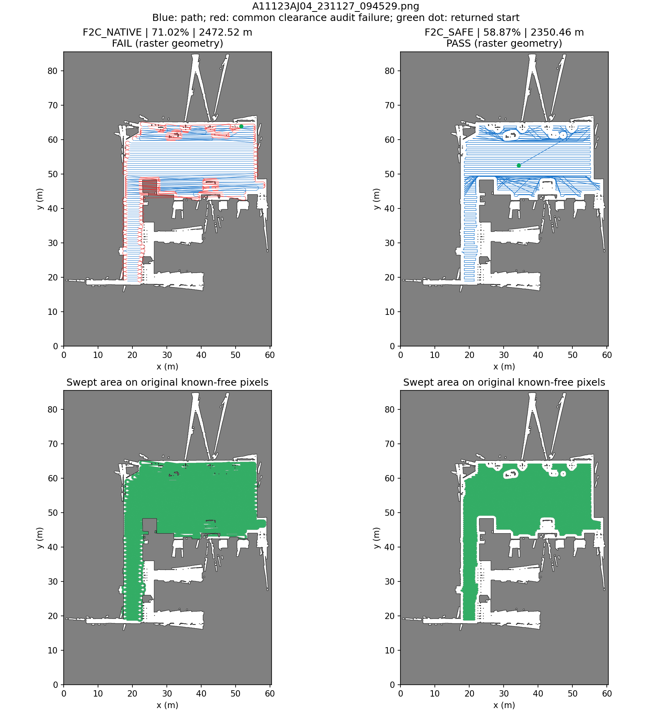
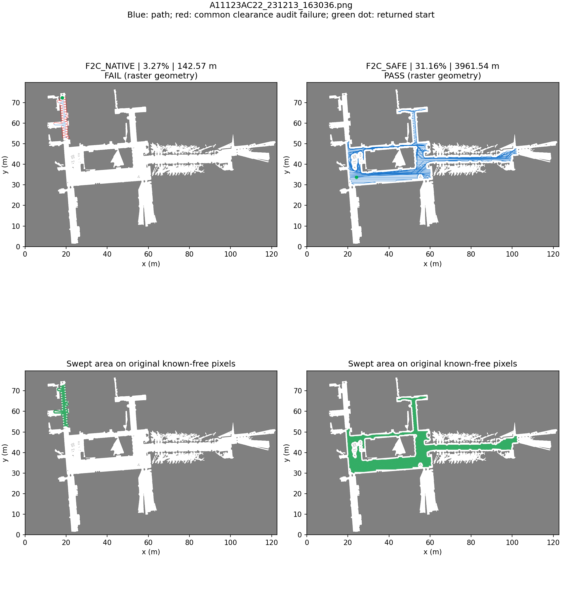
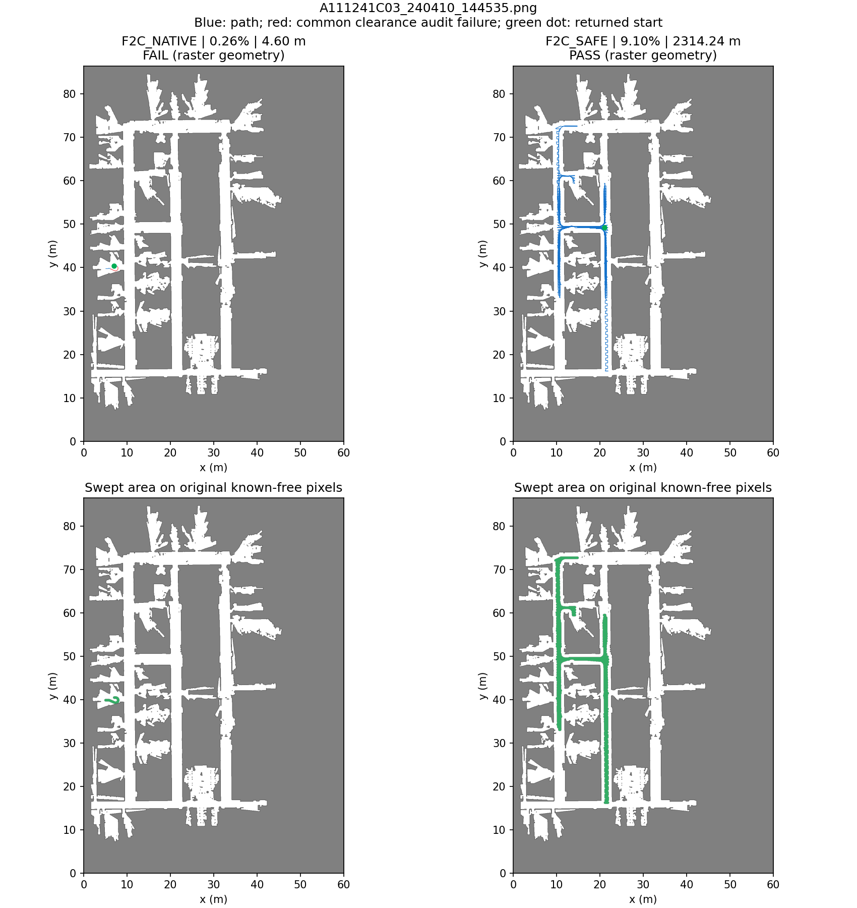

# Fields2Cover 条带与连接避障对照

2026-10-28，同一组三张原始 PNG，保留原生基线，新增 **Fields2Cover＋净空条带＋栅格 A***。新版本的三条完整输出都通过共同障碍/1 m 净空栅格审计；只验证规划几何，没有执行运动。

## 三项指标

| 场景 | 版本 | 全图自由区覆盖率 | 完整路径长度 | 栅格几何有效性 |
| --- | --- | ---: | ---: | --- |
| AJ04 | 原生 | 71.02% | 2,472.52 m | 未通过 |
| AJ04 | 净空条带＋A* | 58.87% | 2,350.46 m | 通过 |
| AC22 | 原生 | 3.27% | 142.57 m | 未通过 |
| AC22 | 净空条带＋A* | 31.16% | 3,961.54 m | 通过 |
| C03 | 原生 | 0.26% | 4.60 m | 未通过 |
| C03 | 净空条带＋A* | 9.10% | 2,314.24 m | 通过 |

[CSV](summary.csv) · [运行/实现/原图及文件指纹](manifest.json) · [复算与逐段重放证据](verification.json)

这里改变了可规划区域预处理、条带裁剪和连接，并增加起点接近路径；**不是只替换连接器的消融实验，也不是全图覆盖完成**。原生名义覆盖率包括无效连接的扫掠，必须与有效性一起读；新版本保持 F2C 条带顺序，尚未优化任务排序，因此路径也可能很长。

## 原图上的完整轨迹

每图左侧为原生，右侧为修改版；上排蓝/红为通过/未通过共同净空审计的线段，绿点为路线起点，下排绿色为 0.6 m 作业宽度的扫掠并集。新版本所有接缝、起点连接、条带、A*连接均纳入长度及审计。

### AJ04



### AC22



### C03



## 实现修改及分析

- 原生 `PathPlanning::searchBestPath` 以条带端点/方向生成转弯，没有传入栅格障碍约束。自有模块新增精确裁剪、保留合格原生转弯、无切角 8邻接 A*、经碰撞核验的折线简化和最终整路复核；不改固定第三方源码。
- 当前 opennav 的 `HeadlandGenerator::generateHeadlands` 在 buffer 后使用 `getGeometry(0)`，未遍历可能分裂出的全部区域。修改版直接选公共起点所在的精确净空分量，单独矢量化并回填核验，在该区域重新由 F2C 生成条带，关闭额外 headland 避免二次内缩。故不能将 AC22 的覆盖变化全部归因于连接修改。
- 三图作业宽度均 0.6 m，中心净空均 1.0 m；地图直接读 PNG，0.05 m/像素及零原点为沿用的元数据假设。自由条件 `(255-gray)/255 < 0.25`，包含灰度200；未知和图外不可走。
- 覆盖率分母始终是原图全部已知自由像素：AJ04 507,209，AC22 645,425，C03 453,369；没有改成净空区分母。净空后的其他分量仍算未覆盖。
- 公共起点可达净空分量像素为 AJ04 278,927、AC22 170,405、C03 20,259；被排除的净空像素为 16,184、71,313、25,391。当前方案不跨不连通区跳接，也不宣称完整覆盖全图。
- 本轮三图分别使用 102、153、119 次 A*；保留的原生转弯均为 0。所有条带来自真实原生 action，而非自造 zigzag；另一次 `generate_path=False` 请求取得原始有序条带，用来核对原生完整路径中转弯索引是否仍适用。
- 保留 F2C 排序会出现较长的跨条带往返，尤其 AC22/C03；这轮完成避障与溯源，没有做区域分解、顺序优化或参数搜索。

## C03 原生转弯异常与回退

首次 C03 请求已成功返回146条有序条带，但可选完整转弯生成进程退出 `-9`；同一时段内核记录 opennav 进程因 OOM 被终止（约6.7 GB匿名常驻内存）。保留了 [首次原生失败返回](diagnostic_c03_initial_native_failure.json) 和 [对应内核记录](diagnostic_c03_kernel_oom.txt)。它们是诊断证据，不参与最终表格重复计数。归档服务日志仅去除行尾空格。

现对原生服务设置 **2 GiB RLIMIT_AS**。最终运行中，C03 的可选原生转弯返回 action status=6、error_code=801；服务日志为 `std::bad_alloc`，服务随后正常关闭（进程退出0）。见 [受限运行日志](diagnostic_c03_bounded_server.txt)。已有的成功有序条带完整保留，不冒充原生转弯成功。修改版仅使用这些条带＋A*，最终1502点、119次A*，完整轨迹通过共同栅格审计。原生进程已退出；错误和资源限制记录在 safe/candidate JSON 中。

## 模块及逐段溯源

```text
原图 → map_io（自由区/精确净空/公共起点）
     → f2c_safe（起点可达范围、精确多边形）
     → f2c_worker（固定原生条带/转弯、生命周期与资源限制）
     → swath_geometry（精确裁剪）
     → grid_connector（A*、禁止切角、检查后折线简化）
     → obstacle_connector（接缝组装、逐段来源、整路复核）
     → metrics / f2c_compare / verify_f2c
```

- `<场景>_native.json`：原生基线路径、原生 swaths/turns、状态及三项指标。
- `<场景>_candidate.json`：新输入上的真实有序条带、原生完整路径的分组及转弯；若原生转弯失败，保留成功的条带及明确错误。
- `<场景>_safe.json`：修改后完整世界 XY 路径；`details.path_sections` 对每条边给出唯一分段归属，含 `begin_vertex/end_vertex`、`source_swath_index`、原始/裁剪条带、连接 `method`、原生转弯检查结论。`begin/end` 是包含两端的路径顶点索引，相邻段只共享端点，不漏边、不重复归属。
- `manifest.json`：run_id、起止UTC时间、基准代码提交、**实际运行源码内容哈希**、原图/参数和结果文件哈希。运行时实现尚未提交，因此以源码内容哈希锁定版本，不能仅凭旧的基准提交定位新实现。
- safe JSON 同时记录 target/navigable/reachable 掩膜指纹、原生输入多边形、F2C/opennav固定提交、可执行文件/共享库/配置指纹、原生PID/退出状态和地址空间限制。
- `verify_f2c` 从原图重建掩膜及多边形回填，再从原始 swaths 重放路径，逐段核对 trace，并重算长度/覆盖率/有效性与每条路线256个独立距离见证；只读重放，不重跑原生规划。

## 验证范围与边界

这是 BG1 可停车转向模式的折线几何规划，不保持 Dubins 最小半径、曲率连续或端点航向；没有曲线平滑。轨迹通过共同精确 EDT 栅格审计不等于真实 footprint、跟踪误差、运动或真机验收。

独立审查指出：原生条带/转弯沿用半开栅格的边界语义，零长度触角可能被接受；A*和其简化另禁止切角。三图未发现此差异影响结果，本轮保留并明确该限制，不宣称连续几何零接触保证。

复现、依赖和代码入口见 [模块说明](../../../coverage_benchmark/README.md)；[设计](../f2c-obstacle-design.md) 与 [计划](../f2c-obstacle-plan.md) 记录方案。之前 [三算法九组](../three-planners-2026-10-27/README.md) 和 [原 AJ04/F2C 基线](../2026-10-27-A11123AJ04/README.md) 原样保留；本次 AJ04 原生基线与此前路径长度及覆盖率一致。
