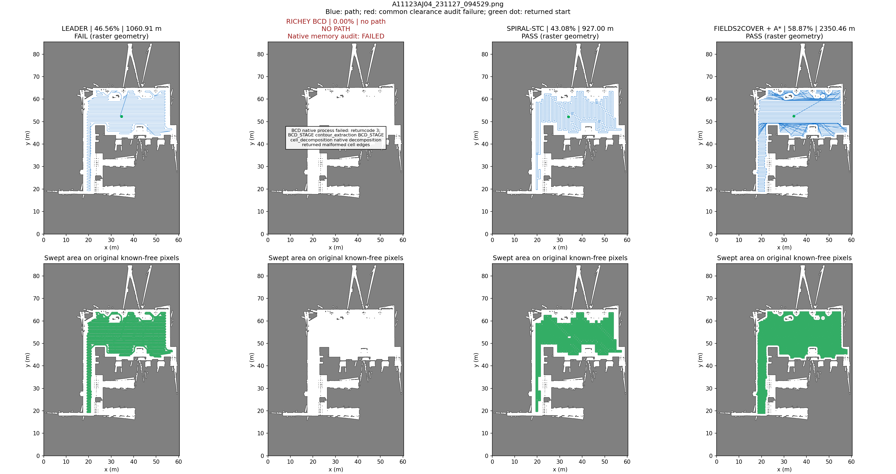
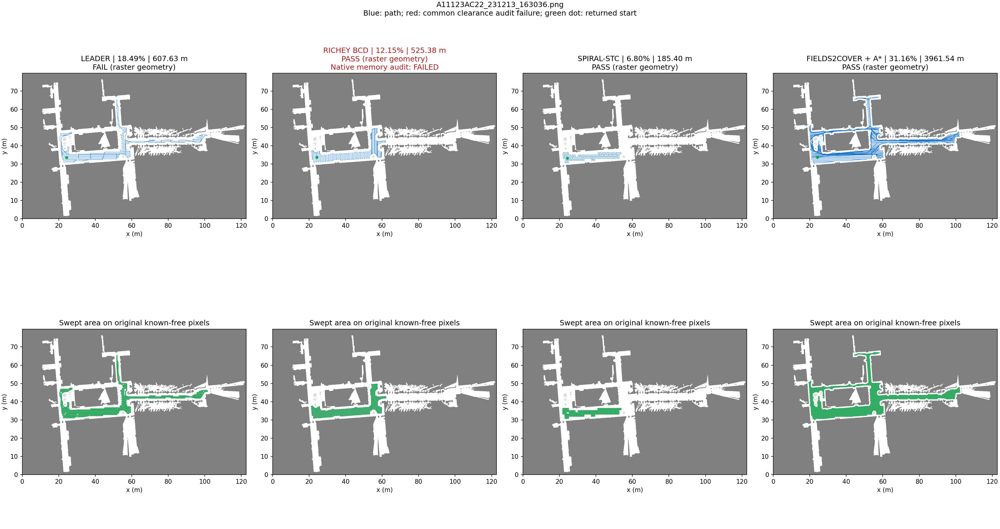
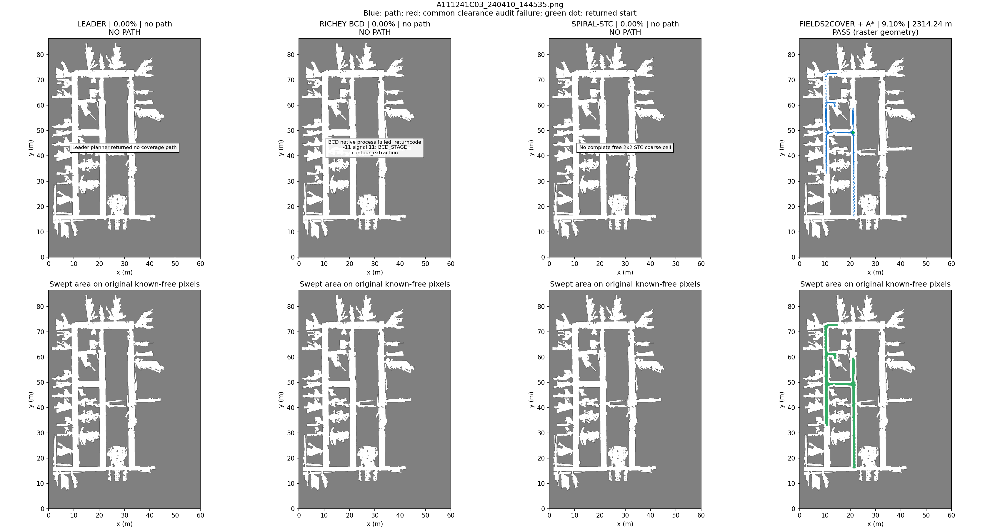

# 四算法统一对比：Leader / BCD / STC / Fields2Cover 修改版

看不懂流程中的具体操作时，可先看 [Leader / Fields2Cover 分镜与Headland特写](../../diagrams/coverage_logic_2026-10-29/README.md)。

2026-10-28 汇总。**复用已经实际跑出的完整路径，未重新运行算法**；先核对两批实验的原图SHA、尺度、公共目标/起点和参数一致，再用同一指标实现重算12组结果。每张图四列分别对应四种实现，上排为全局轨迹，下排为作业扫掠。

## 三项指标总表

| 场景 | 算法（链接到原始路径） | 覆盖率 | 完整路径长度 | 栅格几何有效性 |
| --- | --- | ---: | ---: | --- |
| AJ04 | [Leader](../three-planners-2026-10-27/A11123AJ04_231127_094529_leader.json) | 46.56% | 1,060.91 m | 未通过 |
| AJ04 | [Richey BCD](../three-planners-2026-10-27/A11123AJ04_231127_094529_bcd.json) | 0.00% | —（无路径） | 失败 |
| AJ04 | [Spiral-STC](../three-planners-2026-10-27/A11123AJ04_231127_094529_stc.json) | 43.08% | 927.00 m | 通过 |
| AJ04 | [Fields2Cover＋净空条带＋A*](../f2c-obstacle-2026-10-28/A11123AJ04_231127_094529_safe.json) | 58.87% | 2,350.46 m | 通过 |
| AC22 | [Leader](../three-planners-2026-10-27/A11123AC22_231213_163036_leader.json) | 18.49% | 607.63 m | 未通过 |
| AC22 | [Richey BCD](../three-planners-2026-10-27/A11123AC22_231213_163036_bcd.json) | 12.15% | 525.38 m | 通过* |
| AC22 | [Spiral-STC](../three-planners-2026-10-27/A11123AC22_231213_163036_stc.json) | 6.80% | 185.40 m | 通过 |
| AC22 | [Fields2Cover＋净空条带＋A*](../f2c-obstacle-2026-10-28/A11123AC22_231213_163036_safe.json) | 31.16% | 3,961.54 m | 通过 |
| C03 | [Leader](../three-planners-2026-10-27/A111241C03_240410_144535_leader.json) | 0.00% | —（无路径） | 失败 |
| C03 | [Richey BCD](../three-planners-2026-10-27/A111241C03_240410_144535_bcd.json) | 0.00% | —（无路径） | 失败 |
| C03 | [Spiral-STC](../three-planners-2026-10-27/A111241C03_240410_144535_stc.json) | 0.00% | —（无路径） | 失败 |
| C03 | [Fields2Cover＋净空条带＋A*](../f2c-obstacle-2026-10-28/A111241C03_240410_144535_safe.json) | 9.10% | 2,314.24 m | 通过 |

**BCD 的 AC22 路径通过几何审计，但原生 ASAN 检测到越界读取，不能据此认定实现稳定。** Leader 两张有路径的图未穿原图非自由格，但存在少量严格净空临界段。失败保留为0%覆盖、长度缺失，不当作零长度优势。

[统一CSV](summary.csv) · [来源文件与参数指纹](manifest.json) · [复算证据](verification.json)

## 同图四列轨迹与覆盖

蓝色为通过共同净空审计的线段，红色为不合格线段，绿点为返回路线起点；下排绿色为0.6 m作业宽度的扫掠并集。各列采用同一原图、坐标、范围和比例。BCD 内存异常在图中另行标记。

### A11123AJ04_231127_094529.png



### A11123AC22_231213_163036.png



### A111241C03_240410_144535.png



## 怎么读这个对比

- **AJ04**：Fields2Cover 修改版覆盖58.87%，高于STC的43.08%，两者通过共同栅格审计；对应路径2350.46 / 927.00 m。Leader名义覆盖46.56%，但有严格净空临界段；BCD失败。
- **AC22**：修改版覆盖31.16%，BCD/STC为12.15%/6.80%；修改版路程3961.54 m，也明显更长。BCD有原生内存缺陷；Leader未通过严格净空。
- **C03**：另外三者未生成路径；修改版通过原生有序条带＋A*生成路线，覆盖9.10%。这说明它在当前参数下恢复了部分可达覆盖，不能称全图完成。

## 共同口径与实现差异

- 直接使用同三张 PNG；0.05 m/像素及零原点为沿用的元数据假设。自由条件 `(255-gray)/255 < 0.25`，包含灰度200。覆盖率分母始终是原图所有已知自由像素：507,209 / 645,425 / 453,369。
- 作业宽度/条带间距0.6 m，中心净空1.0 m；全部连接、折返和重复段计长，扫掠只计并集。无效段仍计名义覆盖率，因此必须同时读取有效性。
- 公共原始目标均为最大四邻接自由分量；各实现的内部可规划范围不同。Leader保留原生净空/粗格；BCD有原生额外0.55 m内缩；STC以保守2×2粗格遍历；Fields2Cover修改版在公共起点净空可达区重新生成条带，再裁剪/A*连接，其他分区仍计为未覆盖。
- 修改版包括显式起点接近，其他实现保留原生起点和对应既有统计。这是具体实现流水线的对比，不是只替换连接器的消融实验或算法族排名。覆盖更多通常也要走更长，不能只凭长度判断优劣。
- Fields2Cover修改版是可停车转向的折线几何路径，未保持Dubins最小半径。C03可选原生转弯失败的记录保留，最终路线由成功的真实有序条带＋A*生成。
- 有效性为共同半开栅格/精确EDT审计，原生片段擦角规则、连续footprint和实际运动尚未统一验证；没有启动ROS规划器、Gazebo或运动来生成本次汇总。

## 来源与复现

原始路径保持在各自实验目录；本目录不复制或改写路线，只保存源文件SHA和重算的三项指标。地图元数据及两份输入manifest必须完全一致，F2C修改版源记录还须符合原实验artifact SHA，否则拒绝混比。

- [Leader / BCD / STC 原实验](../three-planners-2026-10-27/README.md)：固定版本、原始路径、BCD原生诊断。
- [Fields2Cover 原生/修改版原实验](../f2c-obstacle-2026-10-28/README.md)：模块、逐边来源、资源限制和原生失败回退。
- [模块及复现入口](../../../coverage_benchmark/README.md)。

```bash
python3 -m coverage_benchmark.compare_saved
```

需要本地三张 PNG；隔离 worktree 可加 `--runtime-root /home/jimmy/Desktop/BG1_Gazebo`，可用 `--output` 另存。不调用规划服务；完整重算12组已保存路径并生成本页、CSV、三张对照图和验证记录。
