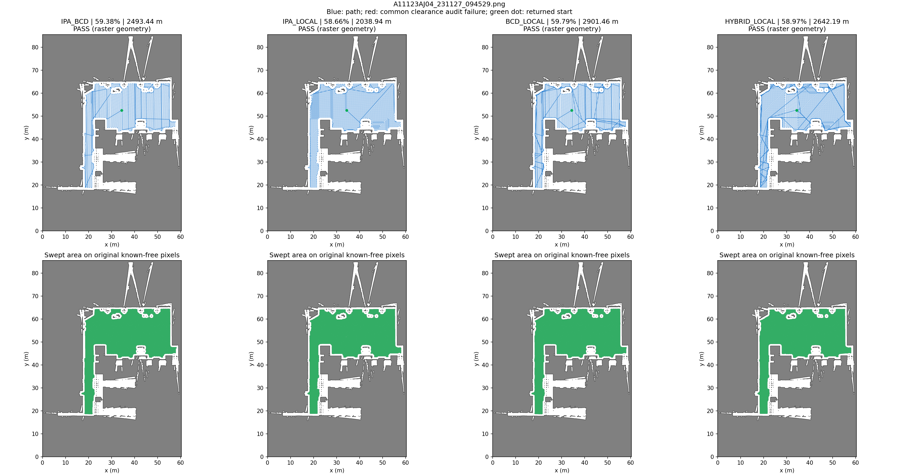
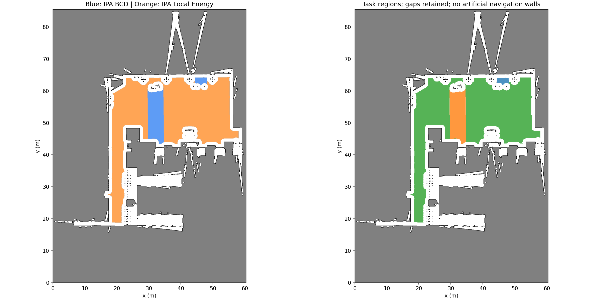
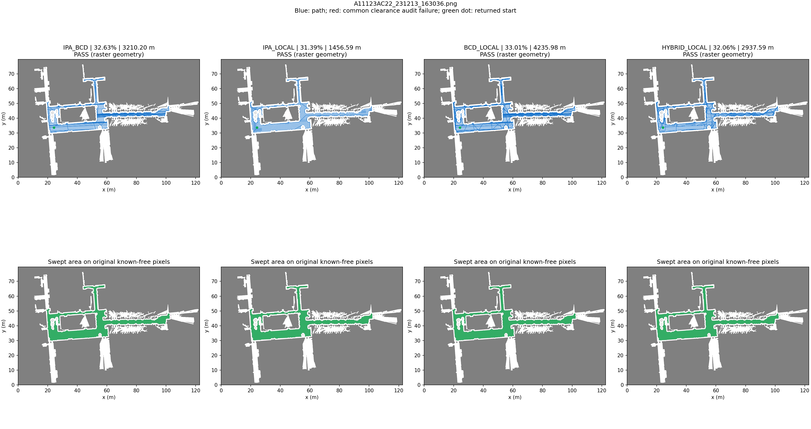
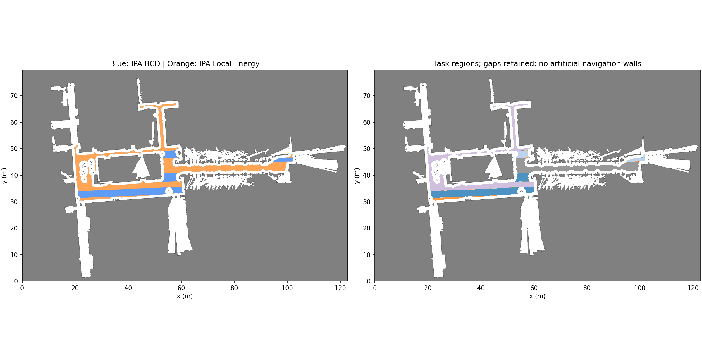
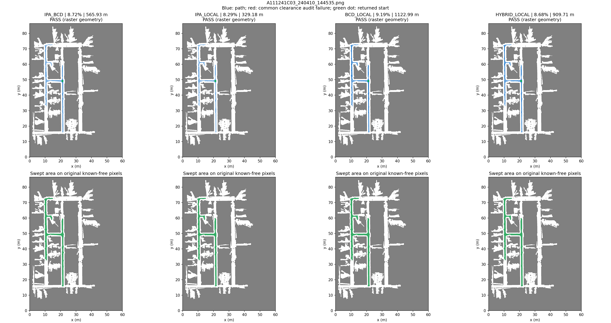
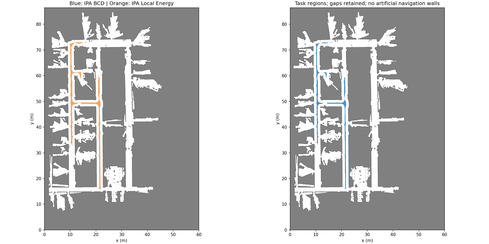

# IPA Hybrid Local-BCD：同输入四组消融

两种内核均来自固定IPA986c183。三个原PNG、同一起点、0.6 m作业宽度、公共1 m净空；新四组均关闭原生额外半格腐蚀。安全模型只在外层应用一次。所有路线包含接近、区间转移和补扫；不运行ROS、仿真或运动。

## 三项指标

| 场景 | 算法 | 覆盖率 | 完整路径长度 | 栅格几何有效性 |
| --- | --- | ---: | ---: | --- |
| A11123AJ04 | [IPA BCD](A11123AJ04_231127_094529_ipa_bcd.json) | 59.38% | 2,493.44 m | 通过 |
| A11123AJ04 | [IPA Local Energy](A11123AJ04_231127_094529_ipa_local.json) | 58.66% | 2,038.94 m | 通过 |
| A11123AJ04 | [IPA BCD＋Local补扫](A11123AJ04_231127_094529_bcd_local.json) | 59.79% | 2,901.46 m | 通过 |
| A11123AJ04 | [IPA分区Hybrid＋Local补扫](A11123AJ04_231127_094529_hybrid_local.json) | 58.97% | 2,642.19 m | 通过 |
| A11123AC22 | [IPA BCD](A11123AC22_231213_163036_ipa_bcd.json) | 32.63% | 3,210.20 m | 通过 |
| A11123AC22 | [IPA Local Energy](A11123AC22_231213_163036_ipa_local.json) | 31.39% | 1,456.59 m | 通过 |
| A11123AC22 | [IPA BCD＋Local补扫](A11123AC22_231213_163036_bcd_local.json) | 33.01% | 4,235.98 m | 通过 |
| A11123AC22 | [IPA分区Hybrid＋Local补扫](A11123AC22_231213_163036_hybrid_local.json) | 32.06% | 2,937.59 m | 通过 |
| A111241C03 | [IPA BCD](A111241C03_240410_144535_ipa_bcd.json) | 8.72% | 565.93 m | 通过 |
| A111241C03 | [IPA Local Energy](A111241C03_240410_144535_ipa_local.json) | 8.29% | 329.18 m | 通过 |
| A111241C03 | [IPA BCD＋Local补扫](A111241C03_240410_144535_bcd_local.json) | 9.19% | 1,122.99 m | 通过 |
| A111241C03 | [IPA分区Hybrid＋Local补扫](A111241C03_240410_144535_hybrid_local.json) | 8.68% | 909.71 m | 通过 |

## 分区、补扫和限制

- A11123AJ04_231127_094529：原生BCD 80个cell，分为2个BCD区、9个Local区。Hybrid补扫接受3/3轮，停止：round_budget；F内仍有14格未扫，原图自由残余208129格。相对纯BCD覆盖率变化-0.42个百分点，长度变化+148.76 m。未使用基线路线回退。
- A11123AC22_231213_163036：原生BCD 292个cell，分为5个BCD区、41个Local区。Hybrid补扫接受3/3轮，停止：round_budget；F内仍有31格未扫，原图自由残余438476格。相对纯BCD覆盖率变化-0.57个百分点，长度变化-272.61 m。未使用基线路线回退。
- A111241C03_240410_144535：原生BCD 102个cell，分为0个BCD区、1个Local区。Hybrid补扫接受3/3轮，停止：round_budget；F内仍有0格未扫，原图自由残余414038格。相对纯BCD覆盖率变化-0.04个百分点，长度变化+343.78 m。未使用基线路线回退。

覆盖分母仍是原图所有已知自由格，包括1 m净空排除、起点不可达的区域。F内未扫与原图未扫分别记录，未缩小分母。C为规划路线圆盘扫掠，并非已执行清扫。分区使用宽度归一化的cell宽度、扫线长度、填充比和邻域碎片数；具体值在JSON中。主轮Local目标为区域R、访问初始化使用C；补扫R为原图自由残余，映射成F内圆盘仍能触及R的中心，允许重访中心已扫但工具边缘仍有收益的格点。障碍与绕行始终使用F。

入口选择是最近8个几何候选中的实际A*距离贪心，不保证全局最优。BCD原始旋转候选在F上裁剪，原输出保存在evidence；不安全片段未成为最终路径，其任务仍参与Local补扫。补扫轮数见manifest预算，无正收益立即停止。覆盖未优于BCD时如实保留Hybrid草案，不暗换基线路线。

闭格审计和独立线段/阻塞像素方框解析审计只证明当前静态栅格模型下的路径几何安全，不证明曲率、运动学、整机连续footprint、动态障碍或真机执行。与旧六算法的IPA版本不同：旧版保留原生额外腐蚀，因此本报告为新的四组消融，不能冒充复跑旧版。

## 轨迹与分区图

### A11123AJ04_231127_094529

### A11123AC22_231213_163036

### A111241C03_240410_144535

复现命令见[模块说明](../../../coverage_benchmark/hybrid/README.md)。[manifest](manifest.json)固定源码、构建/运行库、原图、输入、全部证据；[verification](verification.json)逐项独立重放。失败会撤销旧验证证书。
