# AJ04 · IPA BCD 全流程图解

优先打开 [交互报告 report.html](report.html)：逐块缩放 80 区、逐次回放 66 个事件与 61 轮调度。下文为相同正文的静态阅读版。


地图 `A11123AJ04_231127_094529` 的完整过程。原始结果来自 2026-10-30；2026-11-02 增加中间追踪与独立复核。每一块小区域都保留编号。

**怎样看：**先顺着 01–11 看流程；重点看“06 全部区域逐块看”，它提供 80 块分区明细与每块三联放大图。地图可以滚轮放大、按住拖动。66 次分区事件和 61 轮调度都有逐步回放；所有静态图都可点击打开原尺寸。

## 这里的“IPA BCD”，包含哪两部分

本报告解释的是当前四组消融实验里的 `ipa_bcd`：**IPA 原生 BCD 分解 + 原生单 cell 扫线 + 项目自己的跨区调度和安全连接。**没有 Local Energy 调用，也没有 Local 补扫；不能把这条路线当作 IPA ROS action server 原封不动的输出。

原 PNG→自由区 / 1 m 净空 / F→IPA 旋转与 BCD 分解→80 块区内扫线→安全裁剪→61 区贪心调度 + A*→整路与扫掠统计

| 实际运行部分 | 职责与本轮设置 |
| --- | --- |
| map_io.load_map / Python | 阈值、最大连通区、EDT 净空、公共起点。 |
| BoustrophedonExplorer / C++ | 全局旋转、临界切割、cell 标签与轮廓、每个 cell 的扫线和区内连接。 |
| hybrid/native/main.cpp | 直接调用分解与单 cell 扫线；每个 cell 的原生初始 robot_pos 取该 cell 的中心。 |
| hybrid/planner.py / Python | 裁剪、访问顺序、路径正反向、从公共起点连接所有目标。纯 BCD 模式不使用 Hybrid 区域分类来切换内核。 |
| 本轮适配差异 | 关闭原生额外半格腐蚀；外层已应用 1 m 净空。分解传入 min_cell_area = 0、min_cell_width = 0；不是上游默认参数。 |

上游固定提交 `986c18384ed884dadd3bc857cd0c47c13b7d4716`。原生 ROS 的标准 BCD 是算法 2，算法 8 是变体。本次未启动这两个 ROS 服务端文件，也未调用上游整房间的 TSP / LEFT_TO_RIGHT 调度入口。

## 先决定“什么算自由”，再决定“规划哪一片”

输入使用同名 **PNG**，1208 × 1710 像素。概率定义为 `p = (255 − 灰度) / 255`，仅 `p < 0.25` 算已知自由，即整数灰度 ≥ 192。其余像素全部作为不可通行输入；未知区没有补成自由区。

全图有 **507,209** 个自由像素，分成 **114** 个四连通分量。公共输入选择最大的 **470,743** 格作为目标连通区；另外 **36,466** 格没有进入这次规划。后续覆盖率的分母仍保留全部 507,209 格。

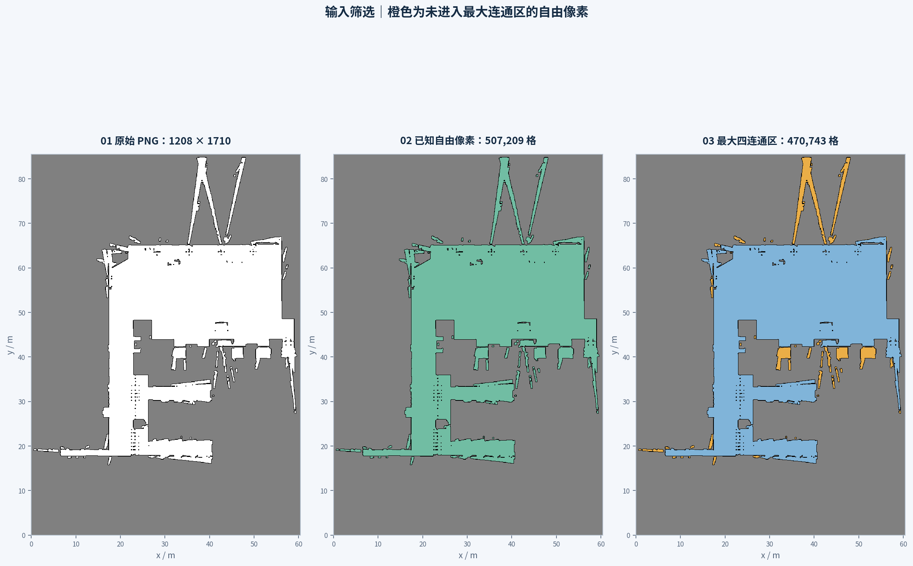

白/黑/灰来自原图；蓝色是最大自由连通区，橙色是其余自由分量。图中是同一张地图。

分辨率沿用同名 PGM 推得的 0.05 m/像素，实际代码以 float32 转为 `0.05000000074505806` m；局部原点人为设为 [0,0,0]，不代表原始世界坐标。数组读取时顶行在上，进入规划后翻转为下左原点，像素中心换算为 `x=(col+0.5)r，y=(H−row−0.5)r`。

## 1 m 净空会断开通道；最后只保留起点能到达的 F

1. 对最大连通区补一圈非自由边界，再做精确欧氏距离变换 EDT。

2. 距离必须严格大于 `ceil(1.0 / r) = 20` 像素，得到 **295,111** 格 navigable。这里的 1 m 是公共栅格净空规则，不是作业宽度。

3. 以 EDT 最大值像素中心作为公共起点 **(34.375001, 52.475001) m**。

4. 再次四连通标记，只取包含起点的分量 F：**278,927** 格。另有 **16,184** 格虽满足净空，仍与起点断开。

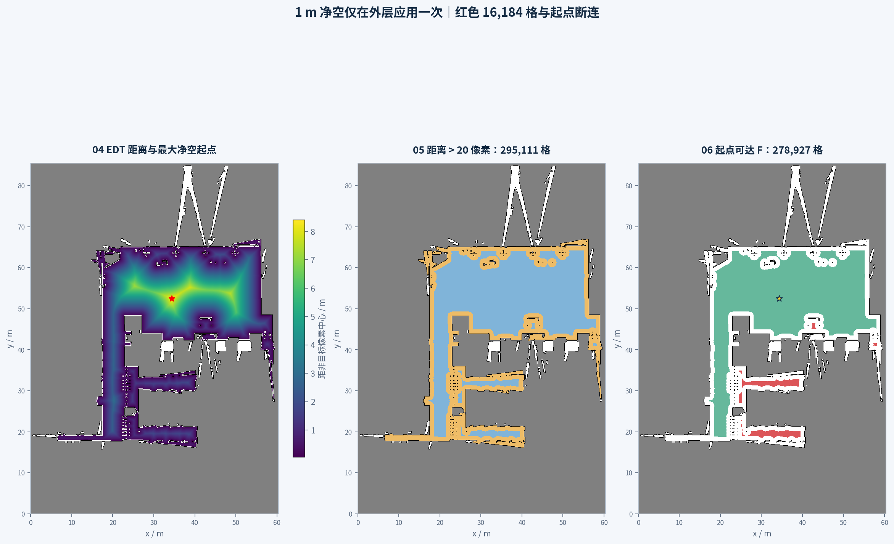

蓝/绿是能走的中心区域；橙色为被净空排除的目标格；最右红色是满足净空却无法从起点到达的区域。

“全图看起来有通道”和“中心在保持 1 m 净空后仍可连通”是不同条件。BCD 只收到 F，不会看到被排除的区域；后面的 80 块都在这个输入上形成。

## 先把主要墙面方向转正，才开始切区

`RoomRotator` 先用 Canny(50,150,3) 提取 F 的边缘，再做 HoughLinesP。起始最短线长为 1 m；本图找到 **92** 条线段，足够使用第一轮参数。线段方向折算到 [0,π]，按长度加权进入 **36 个方向桶**，取权重最大桶内的加权平均方向。

AJ04 的全局旋转参数为 **+90.5080880999°**（OpenCV 约定），不是恰好 90°。**如果旋转前后都按 y 向上显示，这个矩阵表现为顺时针 90.508°。**旋转中心取 F 非零像素包围框中心，扩大画布得到 **1723 × 1225**。使用 `warpAffine / INTER_AREA`，再以 `>127` 二值化；没有形态学闭运算来抹掉细障碍。

**旧图为什么不像只转了 90°：**旧图左边是 y 向上的原地图，右边是行号向下的原生图，且左边还画了 F 以外的地图。两边直接对比时，混入了一次显示上的上下翻转。下面已改成**左、中两张主图都只画同一个 F，纵轴都向上，像素尺度相同**，可用 A、B、C 三个对应点和输入方向箭头核对。右边单列原生行号视图，避免把显示翻转误当成算法又转了一次。


左 → 中：顺时针 90.508°，输入 +x（向右）转为近似向下，输入 +y（向上）转为近似向右；A/B/C 是同三个点。中 → 右：像素数组完全相同，只把纵轴改成向下显示。算法旋转矩阵行列式为 +1，不含镜像。

### 展开精确仿射矩阵与坐标转换

```text
R =
-0.008867694010 0.999960681228 38.183405087700
-0.999960681228 -0.008867694010 1369.830696949500
```

先在下左原点像素坐标上用 R 变换；原生分区/扫线结果以 R⁻¹ 变回，再加半格中心偏移并乘 r。报告中的地图图层均回到同一原图坐标。逐 cell 还会再旋转一次，它与这里的全局旋转是两步。

## 逐行数自由片段；发生分裂或合并时才画边界

从旋转图第一行出现白像素的位置开始，沿 y′ 增大逐行扫描。实现通过“自由→黑色”的过渡计数，并记录障碍起止 x。比较相邻行的片段数：

| 事件 | 触发与检查 | 在哪里画边界 |
| --- | --- | --- |
| IN / 分裂 | 片段数增加；对当前行黑像素检查上一行 x−1、x、x+1 是否全为自由。 | 在当前行向左右延伸，只标记当前/上一行均为自由的像素，遇黑障碍停止。 |
| OUT / 合并 | 片段数减少；回看上一行黑像素，检查当前行的三像素邻域。 | 在上一行向左右延伸；同时检查再上一行，避免把边界铺进障碍。 |
| SHIFT / 横向错位 | 片段数量相同，但相邻行片段位置错开时，也可能触发检查。 | 采用 IN 分支。本图没有触发 SHIFT，不能画一个虚构实例。 |

本图记录了 **31 次 IN + 35 次 OUT = 66 次候选事件**。其中 **30 次**真的新增边界像素，其余只进行了条件检查；最终形成 **79 段连续边界像素**。这些边界在算法内部临时阻断 floodFill，**不是机器人移动障碍墙**。

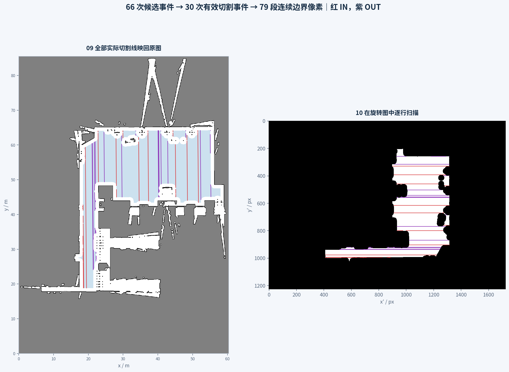

同一批真实切割线，左图映回原图，右图保留旋转坐标。红色 IN、紫色 OUT。

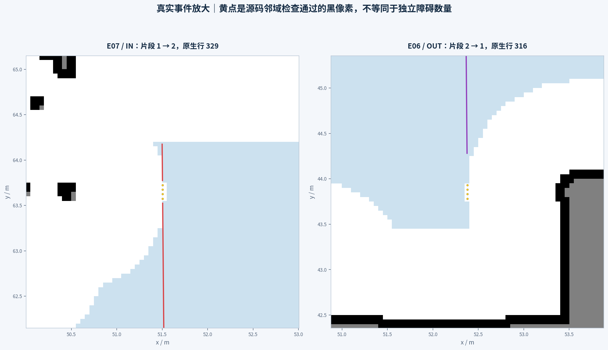

放大切割发生的障碍端部；完整边界见上一图。黄点表示源码检查通过的黑像素位置，同一障碍可以产生多个黄点。

### 展开全部 66 次事件明细

| 事件 | 类型 | 原生行 y′ | 片段变化 | 检查通过的黑像素 | 新增边界段 |
| --- | --- | --- | --- | --- | --- |
| E01 | IN | 256 | 1 → 2 | 0 | 0 |
| E02 | IN | 257 | 2 → 3 | 0 | 0 |
| E03 | OUT | 258 | 3 → 2 | 196 | 2 |
| E04 | OUT | 259 | 2 → 1 | 4 | 3 |
| E05 | IN | 315 | 1 → 2 | 0 | 0 |
| E06 | OUT | 316 | 2 → 1 | 4 | 1 |
| E07 | IN | 329 | 1 → 2 | 4 | 2 |
| E08 | OUT | 331 | 2 → 1 | 0 | 0 |
| E09 | IN | 392 | 1 → 2 | 5 | 2 |
| E10 | IN | 397 | 2 → 3 | 0 | 0 |
| E11 | OUT | 400 | 3 → 2 | 1 | 2 |
| E12 | IN | 459 | 2 → 4 | 13 | 3 |
| E13 | OUT | 463 | 4 → 3 | 0 | 0 |
| E14 | OUT | 467 | 3 → 2 | 0 | 0 |
| E15 | IN | 472 | 2 → 3 | 6 | 2 |
| E16 | OUT | 474 | 3 → 2 | 0 | 0 |
| E17 | OUT | 483 | 2 → 1 | 0 | 0 |
| E18 | IN | 503 | 1 → 2 | 0 | 0 |
| E19 | OUT | 504 | 2 → 1 | 3 | 1 |
| E20 | IN | 541 | 1 → 2 | 0 | 0 |
| E21 | OUT | 543 | 2 → 1 | 5 | 2 |
| E22 | IN | 551 | 1 → 2 | 0 | 0 |
| E23 | IN | 552 | 2 → 3 | 0 | 0 |
| E24 | IN | 554 | 3 → 4 | 0 | 0 |
| E25 | OUT | 555 | 4 → 3 | 5 | 3 |
| E26 | OUT | 557 | 3 → 2 | 4 | 3 |
| E27 | OUT | 559 | 2 → 1 | 3 | 2 |
| E28 | IN | 616 | 1 → 2 | 5 | 2 |
| E29 | OUT | 618 | 2 → 1 | 0 | 0 |
| E30 | IN | 670 | 1 → 2 | 13 | 2 |
| E31 | IN | 684 | 2 → 3 | 0 | 0 |
| E32 | OUT | 687 | 3 → 2 | 4 | 2 |
| E33 | IN | 760 | 2 → 3 | 6 | 2 |
| E34 | OUT | 762 | 3 → 2 | 0 | 0 |
| E35 | OUT | 769 | 2 → 1 | 5 | 2 |
| E36 | IN | 800 | 1 → 2 | 22 | 2 |
| E37 | OUT | 801 | 2 → 1 | 0 | 0 |
| E38 | IN | 869 | 1 → 2 | 0 | 0 |
| E39 | OUT | 870 | 2 → 1 | 2 | 1 |
| E40 | IN | 903 | 1 → 2 | 6 | 2 |
| E41 | OUT | 905 | 2 → 1 | 0 | 0 |
| E42 | IN | 918 | 1 → 2 | 0 | 0 |
| E43 | IN | 919 | 2 → 4 | 0 | 0 |
| E44 | IN | 920 | 4 → 8 | 0 | 0 |
| E45 | OUT | 921 | 8 → 5 | 52 | 4 |
| E46 | OUT | 922 | 5 → 4 | 6 | 10 |
| E47 | OUT | 926 | 4 → 3 | 109 | 3 |
| E48 | OUT | 927 | 3 → 2 | 3 | 4 |
| E49 | IN | 933 | 2 → 3 | 0 | 0 |
| E50 | IN | 936 | 3 → 6 | 0 | 0 |
| E51 | OUT | 937 | 6 → 1 | 18 | 3 |
| E52 | IN | 938 | 1 → 8 | 0 | 0 |
| E53 | OUT | 939 | 8 → 1 | 23 | 1 |
| E54 | IN | 977 | 1 → 2 | 4 | 2 |
| E55 | IN | 978 | 2 → 4 | 21 | 0 |
| E56 | OUT | 979 | 4 → 3 | 0 | 0 |
| E57 | OUT | 985 | 3 → 2 | 0 | 0 |
| E58 | OUT | 988 | 2 → 1 | 0 | 0 |
| E59 | IN | 993 | 1 → 3 | 124 | 3 |
| E60 | IN | 994 | 3 → 4 | 109 | 0 |
| E61 | IN | 995 | 4 → 6 | 45 | 6 |
| E62 | OUT | 996 | 6 → 5 | 0 | 0 |
| E63 | OUT | 997 | 5 → 4 | 0 | 0 |
| E64 | OUT | 998 | 4 → 2 | 0 | 0 |
| E65 | OUT | 999 | 2 → 1 | 0 | 0 |
| E66 | OUT | 1023 | 1 → 0 | 0 | 0 |

## 80 块是怎么数出来的；为什么有这么多小块

临时边界标记后，对剩余白像素用 **四连通 floodFill** 逐块标记：得到 80 个标签。再建立边界两侧 cell 的邻接关系；上游支持把太小的 cell 并入最大邻区，但本轮传入面积/宽度阈值都是 0，**没有合并任何 cell**。只把临时边界像素分给相邻的大区域，再提取每个标签的外轮廓。

`GeneralizedPolygon` 用填充轮廓后的非零像素数定义面积，不是直接用连续多边形面积公式。随后用距离变换和 MeanShift 求 cell 内部中心。标签面积与填充轮廓面积可能不同，CSV 分别列出。输出索引从 0 开始，所以 **C00 对应原生标签 1，C79 对应标签 80**；编号不是访问顺序。

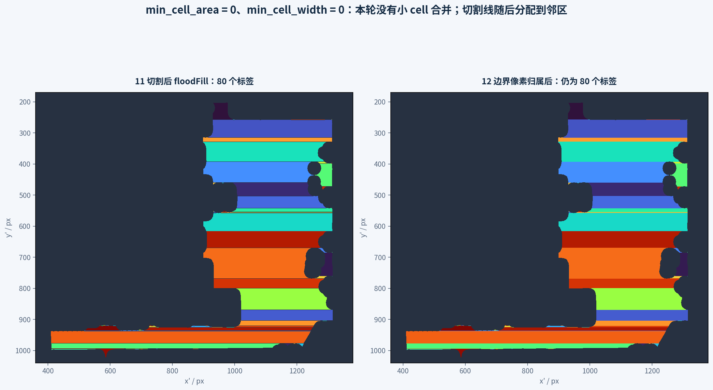

原生标签图直接来自追踪副本。合并前 80 块，处理后仍为 80 块。

80 块中有 **55 块小于 1 m²**，最小只有 **1 像素 = 0.0025 m²**。接近 90° 的旋转、像素台阶、障碍端部和逐行变化检查都会留下细碎区域；面积阈值 0 使它们全部保留。这里的 80 是原生 BCD cell 数，**不是 Hybrid 聚合后的任务区数量**。

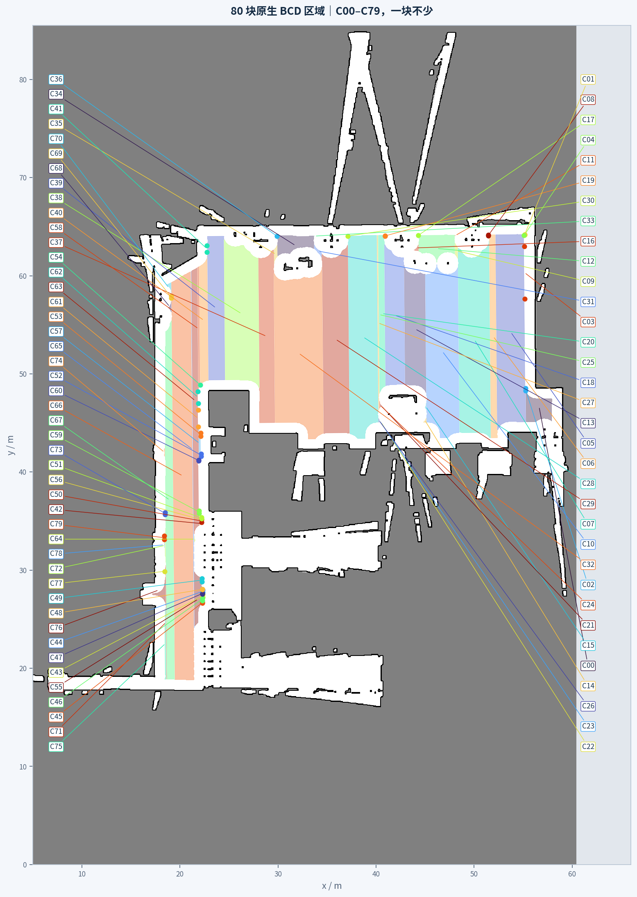

C00–C79 全部引出标注；点状 cell 也保留。点击打开可放大的 SVG，下面逐区查看解决密集区域重叠问题。

## 全部 80 块，都可以单独定位、放大和查看扫线

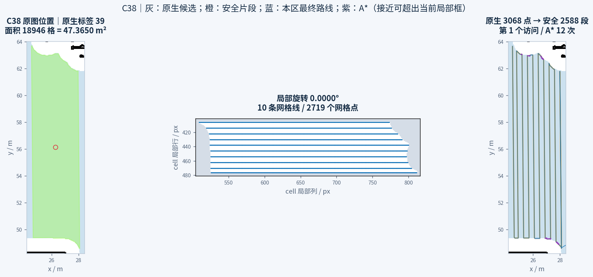

三联放大图：左为原图位置，中为再旋转后的真实像素与网格，右为路径。三个面板坐标系不同，均有单位；接近路线超出局部框的部分在上方交互图查看。

### 区域总表

面积按原生填充像素计；“访问 #”是最终调度次序。点击一行即可切换上面的地图。[下载完整 CSV](cells.csv)。

| 区域 | 标签 | 面积 m² | 原生像素 | 网格线 | 原生点 | 安全段 | 访问 # | A* | 状态 |
| --- | --- | --- | --- | --- | --- | --- | --- | --- | --- |
| C00 | 1 | 6.2450 | 2498 | 8 | 413 | 345 | 38 | 11 | 已访问 |
| C01 | 2 | 0.0050 | 2 | 1 | 1 | 0 | — | 0 | 原生有目标，安全裁剪后无可用段 |
| C02 | 3 | 0.0150 | 6 | 1 | 6 | 1 | 39 | 1 | 已访问 |
| C03 | 4 | 0.2700 | 108 | 1 | 214 | 95 | 31 | 3 | 已访问 |
| C04 | 5 | 0.0025 | 1 | 0 | 0 | 0 | — | 0 | 原生无扫线 |
| C05 | 6 | 55.9250 | 22370 | 8 | 3211 | 2757 | 30 | 4 | 已访问 |
| C06 | 7 | 13.5400 | 5416 | 3 | 1243 | 1137 | 29 | 3 | 已访问 |
| C07 | 8 | 58.8750 | 23550 | 9 | 3405 | 3078 | 28 | 7 | 已访问 |
| C08 | 9 | 0.0075 | 3 | 1 | 4 | 1 | 32 | 0 | 已访问 |
| C09 | 10 | 0.3575 | 143 | 2 | 79 | 64 | 33 | 1 | 已访问 |
| C10 | 11 | 54.3625 | 21745 | 9 | 3032 | 2712 | 37 | 22 | 已访问 |
| C11 | 12 | 0.0100 | 4 | 1 | 4 | 1 | 34 | 1 | 已访问 |
| C12 | 13 | 7.2000 | 2880 | 8 | 507 | 434 | 35 | 3 | 已访问 |
| C13 | 14 | 24.9775 | 9991 | 6 | 1453 | 1299 | 25 | 2 | 已访问 |
| C14 | 15 | 0.0850 | 34 | 2 | 10 | 6 | 27 | 1 | 已访问 |
| C15 | 16 | 0.0550 | 22 | 1 | 17 | 11 | 26 | 2 | 已访问 |
| C16 | 17 | 0.1525 | 61 | 2 | 12 | 10 | 36 | 2 | 已访问 |
| C17 | 18 | 0.0025 | 1 | 0 | 0 | 0 | — | 0 | 原生无扫线 |
| C18 | 19 | 26.8800 | 10752 | 6 | 1922 | 1629 | 24 | 12 | 已访问 |
| C19 | 20 | 0.0050 | 2 | 1 | 1 | 0 | — | 0 | 原生有目标，安全裁剪后无可用段 |
| C20 | 21 | 9.4325 | 3773 | 3 | 677 | 569 | 23 | 4 | 已访问 |
| C21 | 22 | 0.0325 | 13 | 1 | 10 | 7 | 40 | 1 | 已访问 |
| C22 | 23 | 0.0075 | 3 | 1 | 4 | 1 | 45 | 0 | 已访问 |
| C23 | 24 | 0.0200 | 8 | 1 | 4 | 1 | 44 | 1 | 已访问 |
| C24 | 25 | 0.0675 | 27 | 1 | 18 | 11 | 41 | 0 | 已访问 |
| C25 | 26 | 0.8150 | 326 | 1 | 1 | 0 | — | 0 | 原生有目标，安全裁剪后无可用段 |
| C26 | 27 | 0.0400 | 16 | 1 | 4 | 1 | 43 | 1 | 已访问 |
| C27 | 28 | 1.7800 | 712 | 1 | 707 | 592 | 42 | 3 | 已访问 |
| C28 | 29 | 58.9875 | 23595 | 8 | 3646 | 3094 | 22 | 11 | 已访问 |
| C29 | 30 | 48.2850 | 19314 | 8 | 2638 | 2242 | 21 | 8 | 已访问 |
| C30 | 31 | 0.0025 | 1 | 0 | 0 | 0 | — | 0 | 原生无扫线 |
| C31 | 32 | 0.3075 | 123 | 2 | 19 | 17 | 20 | 4 | 已访问 |
| C32 | 33 | 75.9175 | 30367 | 13 | 4139 | 3537 | 46 | 14 | 已访问 |
| C33 | 34 | 0.0075 | 3 | 1 | 4 | 1 | 19 | 1 | 已访问 |
| C34 | 35 | 5.5700 | 2228 | 6 | 403 | 342 | 18 | 6 | 已访问 |
| C35 | 36 | 0.4375 | 175 | 2 | 38 | 28 | 17 | 0 | 已访问 |
| C36 | 37 | 0.0025 | 1 | 0 | 0 | 0 | — | 0 | 原生无扫线 |
| C37 | 38 | 26.6500 | 10660 | 5 | 1483 | 1246 | 16 | 7 | 已访问 |
| C38 | 39 | 47.3650 | 18946 | 10 | 3068 | 2588 | 1 | 12 | 已访问 |
| C39 | 40 | 24.9850 | 9994 | 5 | 1218 | 1013 | 2 | 1 | 已访问 |
| C40 | 41 | 10.3475 | 4139 | 3 | 1020 | 870 | 3 | 6 | 已访问 |
| C41 | 42 | 0.0350 | 14 | 1 | 4 | 0 | — | 0 | 原生有目标，安全裁剪后无可用段 |
| C42 | 43 | 0.0150 | 6 | 1 | 1 | 0 | — | 0 | 原生有目标，安全裁剪后无可用段 |
| C43 | 44 | 0.0175 | 7 | 1 | 6 | 3 | 57 | 0 | 已访问 |
| C44 | 45 | 0.0150 | 6 | 1 | 6 | 3 | 61 | 1 | 已访问 |
| C45 | 46 | 0.0050 | 2 | 1 | 1 | 0 | — | 0 | 原生有目标，安全裁剪后无可用段 |
| C46 | 47 | 0.0150 | 6 | 1 | 1 | 0 | — | 0 | 原生有目标，安全裁剪后无可用段 |
| C47 | 48 | 0.0075 | 3 | 1 | 4 | 1 | 58 | 1 | 已访问 |
| C48 | 49 | 0.0050 | 2 | 1 | 1 | 0 | — | 0 | 原生有目标，安全裁剪后无可用段 |
| C49 | 50 | 0.0200 | 8 | 1 | 8 | 5 | 60 | 1 | 已访问 |
| C50 | 51 | 0.0175 | 7 | 1 | 6 | 3 | 48 | 1 | 已访问 |
| C51 | 52 | 0.0075 | 3 | 1 | 4 | 1 | 47 | 1 | 已访问 |
| C52 | 53 | 0.0150 | 6 | 1 | 6 | 0 | — | 0 | 原生有目标，安全裁剪后无可用段 |
| C53 | 54 | 0.0175 | 7 | 1 | 6 | 3 | 8 | 1 | 已访问 |
| C54 | 55 | 0.0025 | 1 | 0 | 0 | 0 | — | 0 | 原生无扫线 |
| C55 | 56 | 3.3075 | 1323 | 3 | 272 | 207 | 59 | 3 | 已访问 |
| C56 | 57 | 0.2125 | 85 | 2 | 50 | 47 | 49 | 4 | 已访问 |
| C57 | 58 | 0.5850 | 234 | 2 | 128 | 80 | 9 | 3 | 已访问 |
| C58 | 59 | 2.4700 | 988 | 2 | 503 | 430 | 4 | 2 | 已访问 |
| C59 | 60 | 0.0150 | 6 | 1 | 1 | 0 | — | 0 | 原生有目标，安全裁剪后无可用段 |
| C60 | 61 | 0.0050 | 2 | 1 | 1 | 0 | — | 0 | 原生有目标，安全裁剪后无可用段 |
| C61 | 62 | 0.0875 | 35 | 1 | 68 | 55 | 7 | 1 | 已访问 |
| C62 | 63 | 0.0625 | 25 | 1 | 10 | 2 | 6 | 0 | 已访问 |
| C63 | 64 | 15.4050 | 6162 | 3 | 1337 | 1209 | 5 | 3 | 已访问 |
| C64 | 65 | 0.0475 | 19 | 1 | 4 | 1 | 50 | 1 | 已访问 |
| C65 | 66 | 1.9725 | 789 | 1 | 200 | 189 | 15 | 0 | 已访问 |
| C66 | 67 | 82.1375 | 32855 | 6 | 4942 | 4187 | 14 | 10 | 已访问 |
| C67 | 68 | 27.5675 | 11027 | 3 | 2644 | 2174 | 11 | 4 | 已访问 |
| C68 | 69 | 0.1700 | 68 | 2 | 59 | 41 | 12 | 4 | 已访问 |
| C69 | 70 | 0.0125 | 5 | 1 | 4 | 0 | — | 0 | 原生有目标，安全裁剪后无可用段 |
| C70 | 71 | 0.2100 | 84 | 3 | 35 | 28 | 13 | 2 | 已访问 |
| C71 | 72 | 0.6300 | 252 | 1 | 464 | 387 | 56 | 0 | 已访问 |
| C72 | 73 | 0.2975 | 119 | 1 | 140 | 129 | 53 | 1 | 已访问 |
| C73 | 74 | 0.0125 | 5 | 1 | 4 | 0 | — | 0 | 原生有目标，安全裁剪后无可用段 |
| C74 | 75 | 0.0650 | 26 | 1 | 34 | 31 | 10 | 0 | 已访问 |
| C75 | 76 | 1.0025 | 401 | 2 | 439 | 342 | 55 | 1 | 已访问 |
| C76 | 77 | 0.9800 | 392 | 5 | 183 | 143 | 54 | 7 | 已访问 |
| C77 | 78 | 0.0025 | 1 | 0 | 0 | 0 | — | 0 | 原生无扫线 |
| C78 | 79 | 0.0350 | 14 | 1 | 24 | 21 | 51 | 1 | 已访问 |
| C79 | 80 | 0.0200 | 8 | 1 | 8 | 3 | 52 | 1 | 已访问 |

## 每一个 cell 内部，如何变成弓字路径

1. **画单 cell 掩膜。**轮廓填成白色，周围为黑色；以 cell 包围框中心计算第二次旋转。再旋转的方向仍由 Hough 主方向确定，不是简单比较矩形长宽。

2. **确定可扫像素。**将整房间旋转到 cell 坐标，与 cell 掩膜共同检查；本轮关闭原生额外半格腐蚀，保留既有 F 安全边界。

3. **生成网格线。**从可扫最小行开始，行距 `floor(0.6 / √2 / r) = 8 px ≈ 0.40 m`，半格 4 px；沿行每 1 px 采样。末行若不足完整行距，可落在最大有效行。`max_deviation_from_track=0`，本次不做上下偏移补线。

4. **选择起始角。**取首行与末行左右端点共四角，从 cell 中心调用 IPA 原生 A* 比较距离，选择最小者。代价单位是像素路径长度，`1e100` 表示不可达。

5. **排列区内路线。**根据角点选择从首行或末行开始，按行左右交替；行间使用 IPA 的区内 A*。源码还包含首行起始连接，可能产生重复经过，报告保留实际输出。

6. **输出并变回原图。**`path_eps=1.0` 像素控制采样保留；末端会额外加入，因此可出现重复目标点。先逆 cell 旋转，再逆全局旋转，最后换成米制坐标。

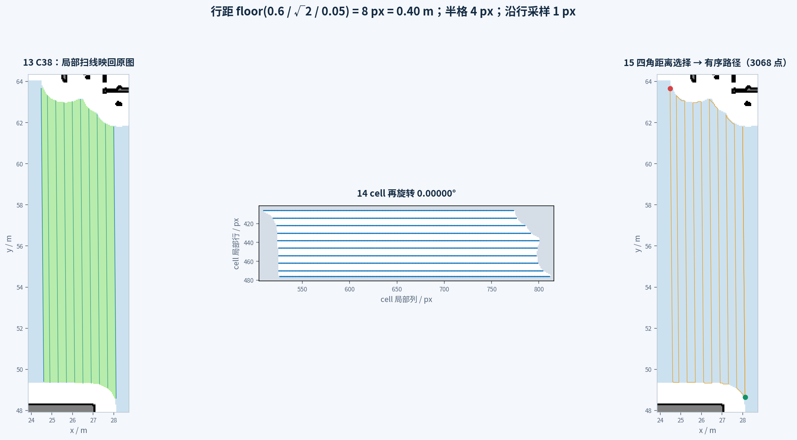

例子 C38：原生 3068 个目标点。这里选角时以 cell 中心为出发点；真正的机器人公共起点接近及 cell 正反向选择在后面的 Python 调度阶段发生。

**6 个单像素区域为什么没有扫线：**C04、C17、C30、C36、C54、C77。追踪表明，它们在局部仿射变换与二值化后白像素数均为 0，后续网格为空；不能只笼统解释成“算法忽略小区域”。逐区图保留原始像素中心投影，展示白格消失的位置。

## 原生输出还不是最终路线：先回到原图裁剪

80 块 cell 共返回 **46,243** 个原生目标点。适配层先去相邻重复点、合并满足数值判据的共线点，再对每段与原分辨率 F 栅格边界求交，保留自由段。切出的边界端点必要时略向内缩，随后做严格闭格安全检查；没有把障碍像素改成自由。

最终得到 **39,465** 个可用安全片段，归属 **61** 个 cell。片段总长度 **2263.492542 m**；原生各 cell 路径长度之和为 **2321.870645 m**。两者都还不包含全部跨段与跨区连接，不能当最终整路长度。

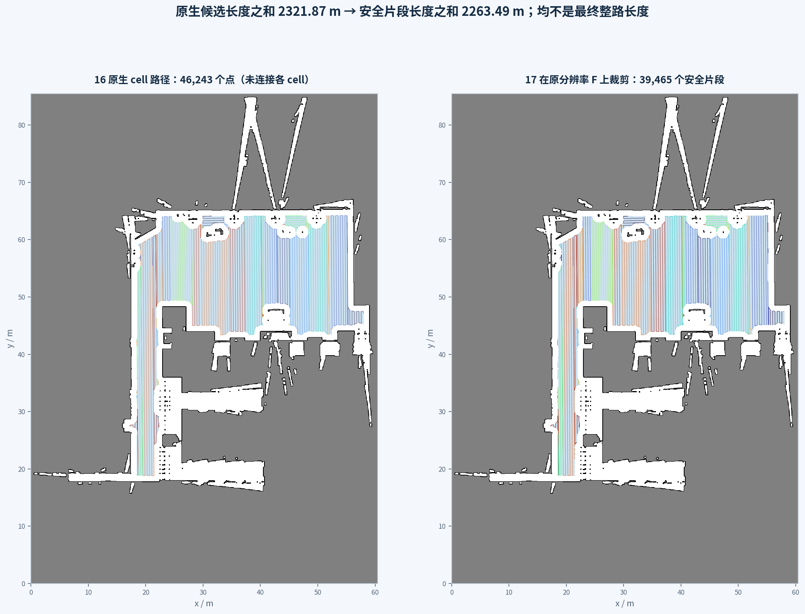

颜色区分原生 cell。左右没有用直线擅自连接不同 cell，因此这里不是一条连续全局路线。

| 未单独调度的原因 | 数量 | 区域 |
| --- | --- | --- |
| 局部重采样后无白格，原生无扫线 | 6 | C04、C17、C30、C36、C54、C77 |
| 原生只给一个目标点，无法构成非零长度片段 | 9 | C01、C19、C25、C42、C45、C46、C48、C59、C60 |
| 原生有很短的路径，原图 F 裁剪后没有可用段 | 4 | C41、C52、C69、C73 |

19 块没有被单独访问，不意味着每块都完全没被扫到：邻区路线和连接段的 0.6 m 作业圆盘仍可能覆盖它们。它们没有从地图自由面积分母中删除。`rejected_candidate_segments=0` 仅表示裁剪后没有片段在后续严格检查中被拒绝，不表示所有原生线段都完整保留。

## 从公共起点开始，每轮比较真实接近距离

纯 BCD 把所有有安全片段的 cell 放入待访问列表，不采用 Hybrid 的 BCD/Local 分类。每个 cell 提供两个候选入口：整段序列的首端，以及把整段序列反过来后的首端。每轮先按当前端点到候选入口的直线距离排序，只取最近 **8** 个候选；再用安全连接器计算实际路径长度，选最短者，相同长度按 cell 索引、正反向确定。

胜出后连接并加入该 cell 的全部片段目标，更新当前位置，然后进入下一轮。本次共 **61 轮**，首轮是 **C38 正向**，公共起点接近长度 **7.343333 m**。这是有候选上限的贪心顺序，不是 IPA TSP，也不保证全局最短。

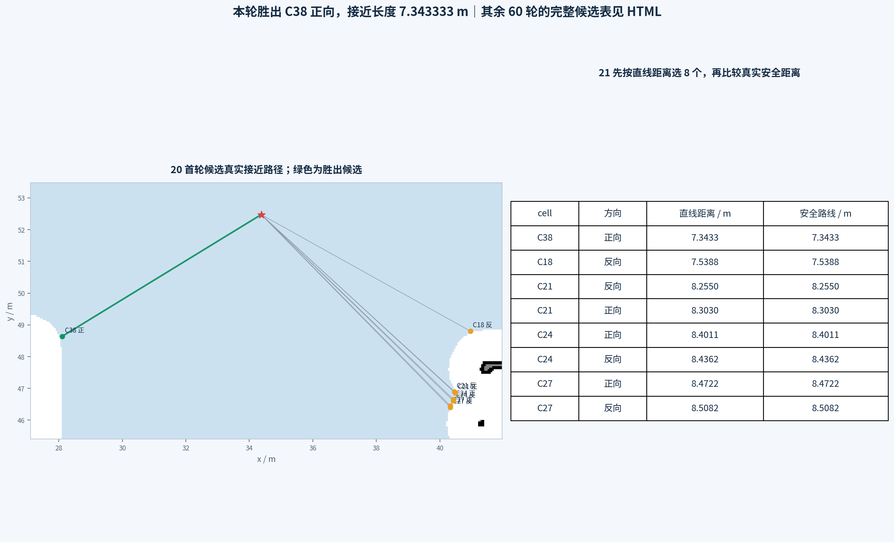

这里的代价以米计；与原生单 cell 的四角像素距离是不同阶段、不同单位。

### 展开全部访问顺序及每区长度

| 访问 # | 区域 | 方向 | 接近 m | 含接近长度 m |
| --- | --- | --- | --- | --- |
| 1 | C38 | 正向 | 7.343333 | 161.113035 |
| 2 | C39 | 反向 | 0.111804 | 60.759060 |
| 3 | C40 | 正向 | 2.055482 | 53.403052 |
| 4 | C58 | 反向 | 0.111804 | 25.386891 |
| 5 | C63 | 正向 | 0.012199 | 66.880412 |
| 6 | C62 | 正向 | 0.581988 | 0.931994 |
| 7 | C61 | 反向 | 1.974464 | 5.224463 |
| 8 | C53 | 反向 | 2.407349 | 2.557355 |
| 9 | C57 | 反向 | 2.363755 | 8.842707 |
| 10 | C74 | 正向 | 3.606246 | 5.156243 |
| 11 | C67 | 反向 | 0.300000 | 134.819205 |
| 12 | C68 | 反向 | 1.539734 | 4.585322 |
| 13 | C70 | 反向 | 1.007577 | 2.562361 |
| 14 | C66 | 正向 | 0.023268 | 249.713887 |
| 15 | C65 | 正向 | 0.032472 | 9.882484 |
| 16 | C37 | 反向 | 6.989674 | 81.652196 |
| 17 | C35 | 正向 | 0.058379 | 1.853348 |
| 18 | C34 | 反向 | 0.175488 | 18.859585 |
| 19 | C33 | 正向 | 3.717955 | 3.767957 |
| 20 | C31 | 正向 | 1.965821 | 4.069861 |
| 21 | C29 | 正向 | 0.054526 | 131.806855 |
| 22 | C28 | 反向 | 0.194914 | 183.041274 |
| 23 | C20 | 反向 | 0.158115 | 34.524334 |
| 24 | C18 | 正向 | 3.384221 | 100.284334 |
| 25 | C13 | 正向 | 2.179781 | 74.493088 |
| 26 | C15 | 反向 | 1.150367 | 2.044476 |
| 27 | C14 | 正向 | 1.824668 | 2.166085 |
| 28 | C07 | 正向 | 3.863884 | 174.392007 |
| 29 | C06 | 正向 | 0.658512 | 62.587337 |
| 30 | C05 | 反向 | 0.270404 | 176.304449 |
| 31 | C03 | 反向 | 1.217348 | 11.930236 |
| 32 | C08 | 正向 | 3.842200 | 3.892202 |
| 33 | C09 | 正向 | 4.721869 | 8.546138 |
| 34 | C11 | 正向 | 0.814836 | 0.864832 |
| 35 | C12 | 反向 | 3.392385 | 29.139116 |
| 36 | C16 | 正向 | 1.641396 | 2.225257 |
| 37 | C10 | 正向 | 9.277336 | 162.007320 |
| 38 | C00 | 正向 | 6.901526 | 27.489213 |
| 39 | C02 | 正向 | 3.327391 | 3.369846 |
| 40 | C21 | 反向 | 16.583714 | 16.933711 |
| 41 | C24 | 正向 | 0.210288 | 0.960284 |
| 42 | C27 | 正向 | 0.180279 | 35.960955 |
| 43 | C26 | 反向 | 1.151136 | 1.201138 |
| 44 | C23 | 反向 | 0.205456 | 0.255455 |
| 45 | C22 | 反向 | 0.049999 | 0.099998 |
| 46 | C32 | 反向 | 5.958681 | 212.878644 |
| 47 | C51 | 反向 | 27.314134 | 27.364133 |
| 48 | C50 | 反向 | 0.245230 | 0.395228 |
| 49 | C56 | 正向 | 0.353317 | 2.999587 |
| 50 | C64 | 反向 | 1.782729 | 1.819818 |
| 51 | C78 | 反向 | 3.127380 | 4.177379 |
| 52 | C79 | 正向 | 0.638937 | 0.888933 |
| 53 | C72 | 正向 | 2.608326 | 9.458324 |
| 54 | C76 | 正向 | 1.611928 | 10.928387 |
| 55 | C75 | 正向 | 2.353132 | 24.100071 |
| 56 | C71 | 正向 | 0.225959 | 23.275957 |
| 57 | C43 | 正向 | 9.284106 | 9.434105 |
| 58 | C47 | 正向 | 0.132920 | 0.182919 |
| 59 | C55 | 正向 | 0.250001 | 14.279864 |
| 60 | C49 | 反向 | 1.091449 | 1.341445 |
| 61 | C44 | 反向 | 1.221297 | 1.371301 |

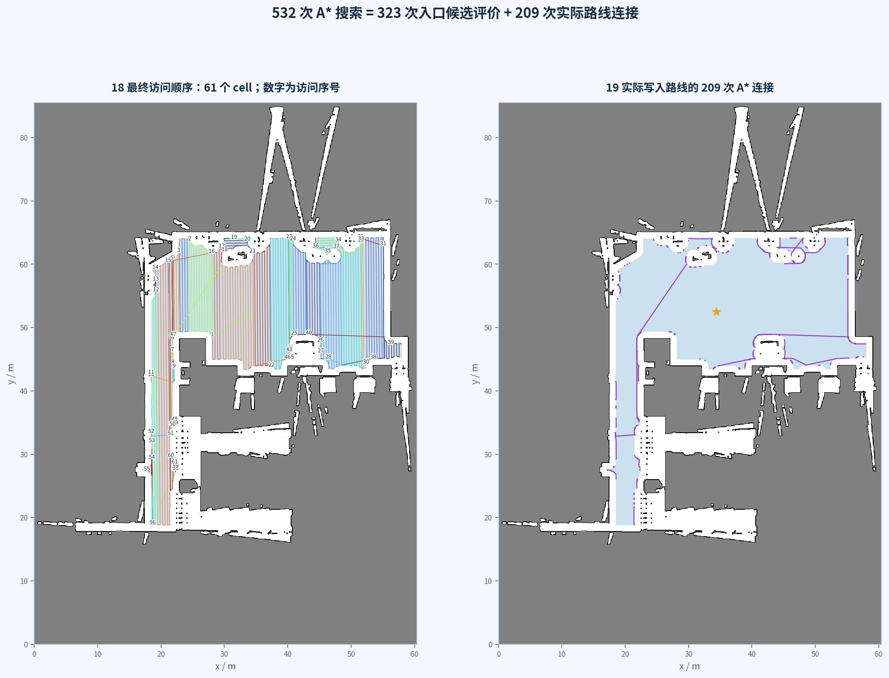

左侧数字是访问序号，不是 C 编号。右侧紫色仅表示实际写入最终路径的 A*，候选评价用过但没有胜出的路径不计入长度。

## 每个目标都必须接上；有视线就直连，否则走 A*

安全片段被展开为起点、终点目标序列，因此本次共有 **78,930 条目标连接记录**。连接器先检查端点与通行连通性；若可见线段合格则直接连接，否则搜索完整 F 上的八邻域 A*。斜向移动必须同时满足相邻两个正交格自由，禁止切角；所得路径经过共线压缩与经检查的视线简化，再做严格闭格复核。

全程 **532 次 A* 搜索**中，**323 次**用于比较入口候选，**209 次**实际加入最终路线。剩余 **78,721** 条目标连接记录为可见直连，其中可以包含零长度连接。不能把 532 当成 532 段实际绕行。

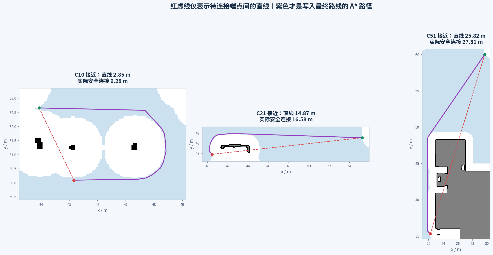

紫色是实际路线，红虚线只表示端点间的直接连线。最左 C10 接近：直线 2.85 m，实际绕行 9.28 m。

连接使用完整 F，分区边界不阻止通行。任一必需连接失败会使该方案失败，不把不连续片段伪装成成功整路。本次最终路径同时通过严格闭格审计和独立“线段与阻塞像素方框相交”解析审计。

## 路线连续安全，但“覆盖了 F”与“覆盖了全图”必须分开

| 项 | 本次证据复算结果 | 含义 |
| --- | --- | --- |
| 完整路线 | 79,225 个顶点 / 2493.437449 m | 含公共起点、所有接近、区内外转移、绕行与重复；不要求回到起点。 |
| 安全片段本体 | 2263.492542 m | 沿已裁剪片段行进的部分。 |
| 每区首次接近之和 | 161.834864 m | 61 次，包括公共起点到第一个区域。 |
| 同区片段之间连接之和 | 68.110043 m | 连接相邻安全片段端点；不是作业宽度的面积统计。 |
| 全自由区覆盖 | 301,205 / 507,209 = 59.384790% | 0.6 m 圆盘沿完整路线扫掠，以原图全部自由像素中心计数。 |
| F 内覆盖 | 278,780 / 278,927 = 99.947298% | F 内还剩 147 格 / 0.3675 m²。 |
| 全图自由残余 | 206,004 格 | 包含净空排除、起点不可达和规划残余；没有从分母扣掉。 |
| 栅格安全 | 碰撞段 0 / 公共净空违规段 0 | 最终静态栅格几何通过，不代表实际执行验证。 |

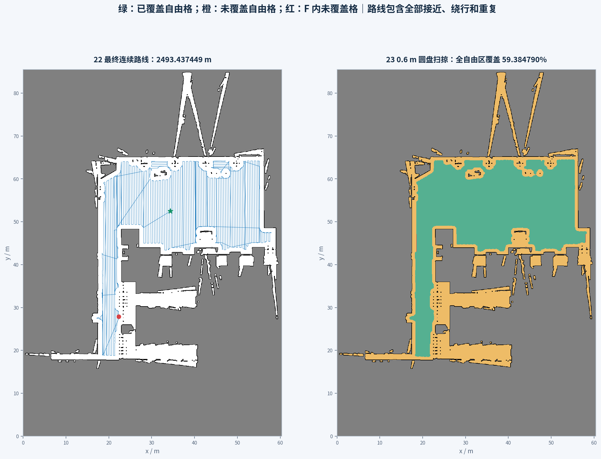

绿色圆盘扫掠会覆盖一些 F 外的自由边带，所以全图已扫 301,205 格可以大于 F 的 278,927 格；机器人中心始终受 F 约束。

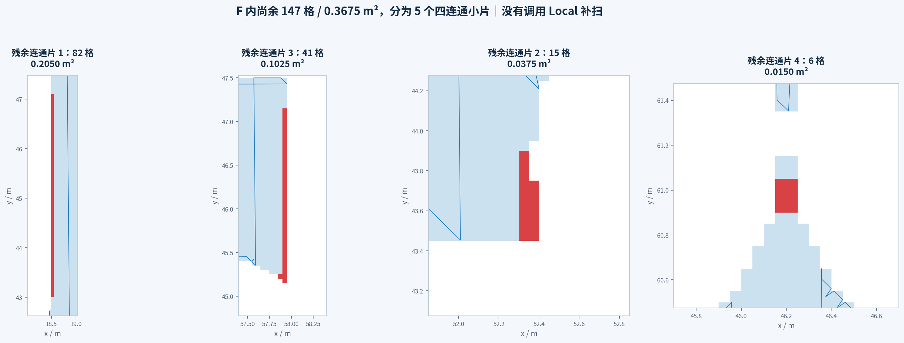

最大几处 F 内残余逐像素放大。纯 BCD 没有 Local 补扫，不能把 99.9473% 写成 100%。

本报告复核的是保存路线和静态几何。没有启动 ROS、Gazebo 或机器人运动，没有验证全程跟踪、曲率、动态避障或真机清扫。原生规划时间为历史记录；本次加记录的追踪耗时不作为算法计时结果。

## 80 块区域的静态放大索引

下列 10 页索引每页 8 块，确保没有漏掉任何分区。每框单独缩放，面积与访问状态写在标题里。更详细的三联图在“06”按编号选择，或展开下方逐区清单。

### 索引 01/10 · C00–C07

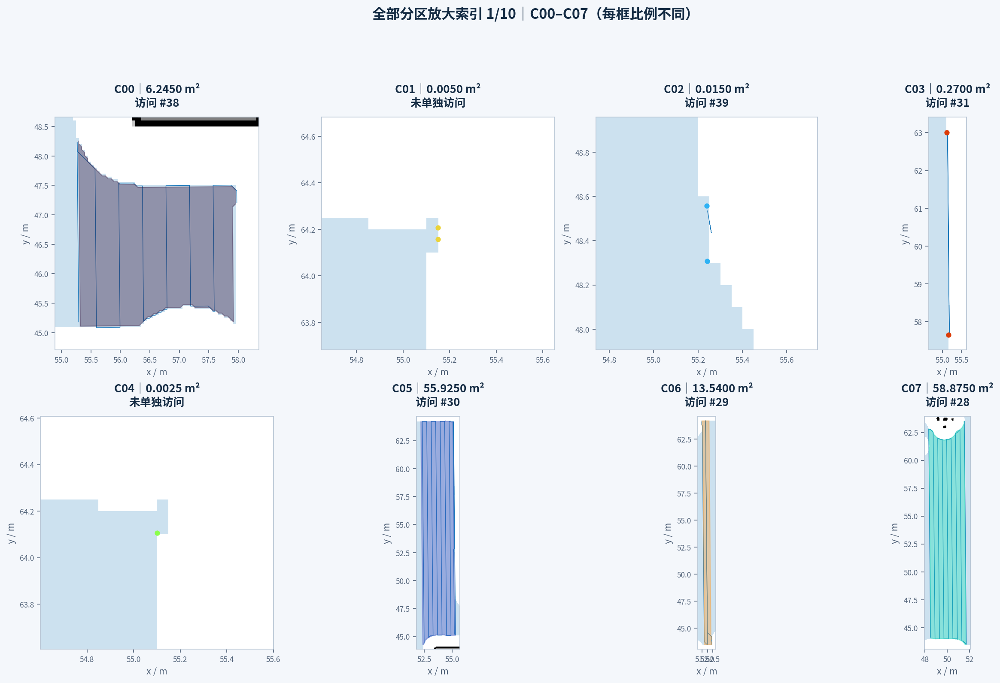

### 索引 02/10 · C08–C15

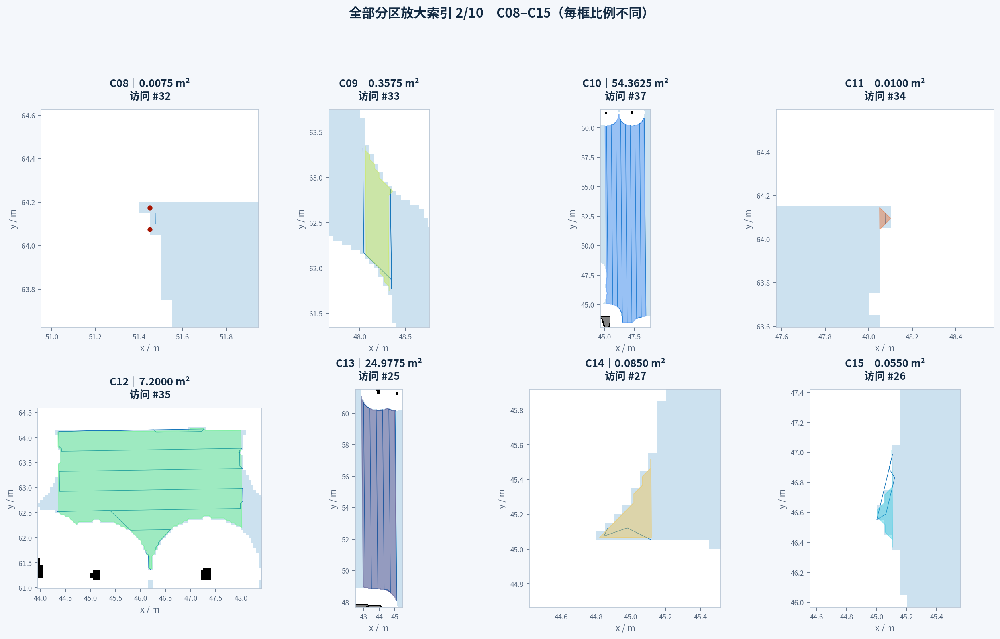

### 索引 03/10 · C16–C23

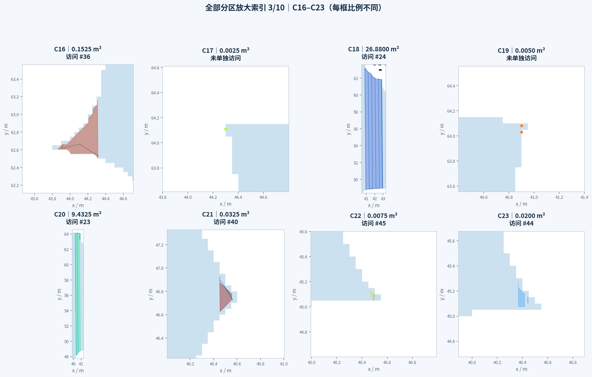

### 索引 04/10 · C24–C31

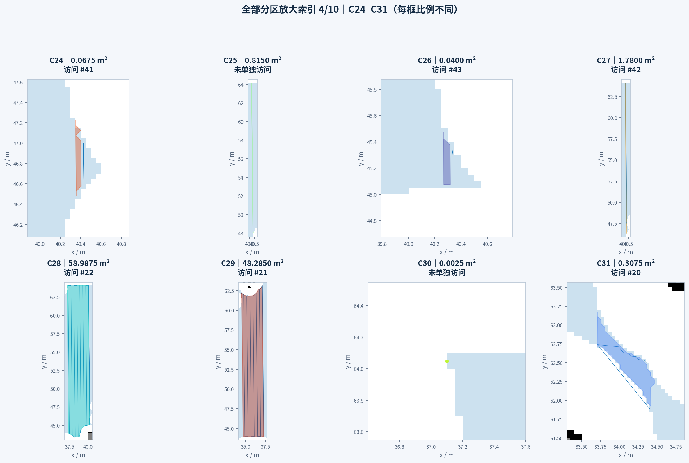

### 索引 05/10 · C32–C39

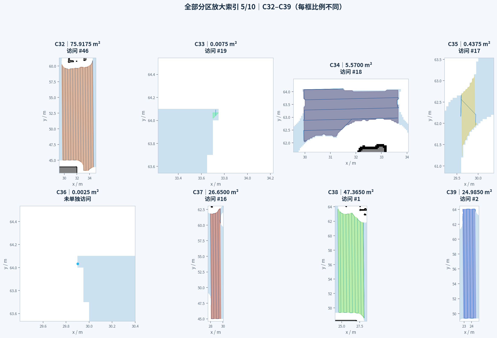

### 索引 06/10 · C40–C47

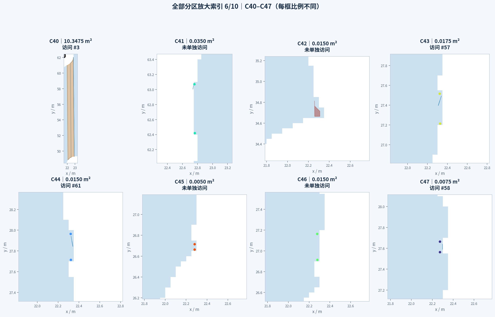

### 索引 07/10 · C48–C55

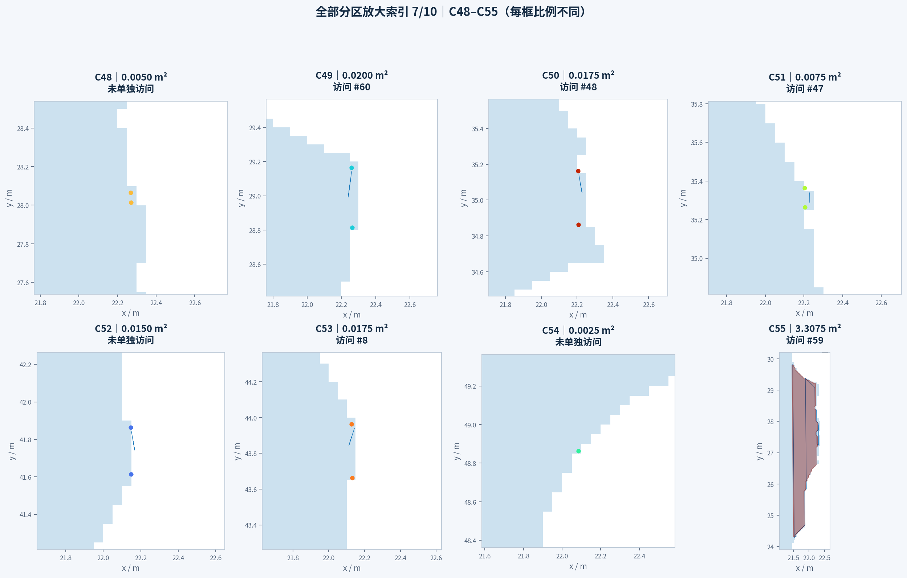

### 索引 08/10 · C56–C63

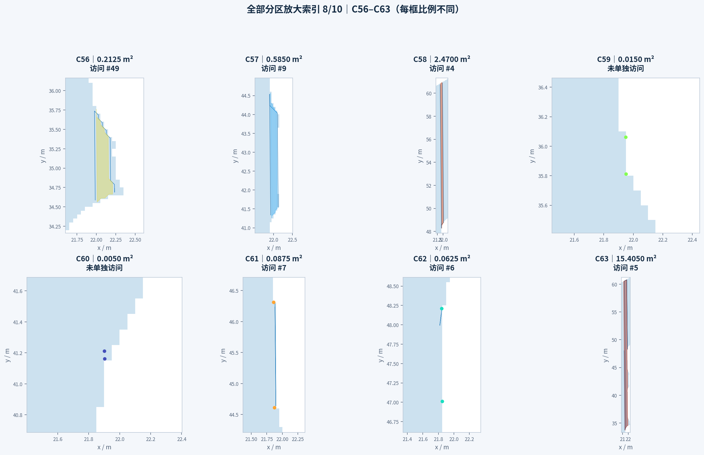

### 索引 09/10 · C64–C71

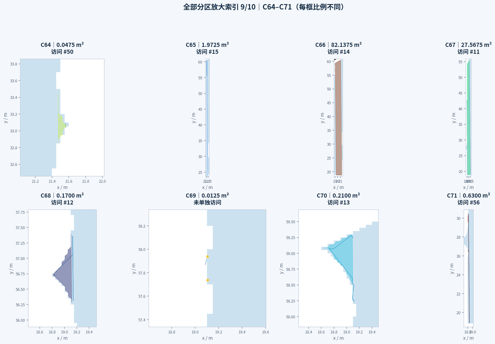

### 索引 10/10 · C72–C79

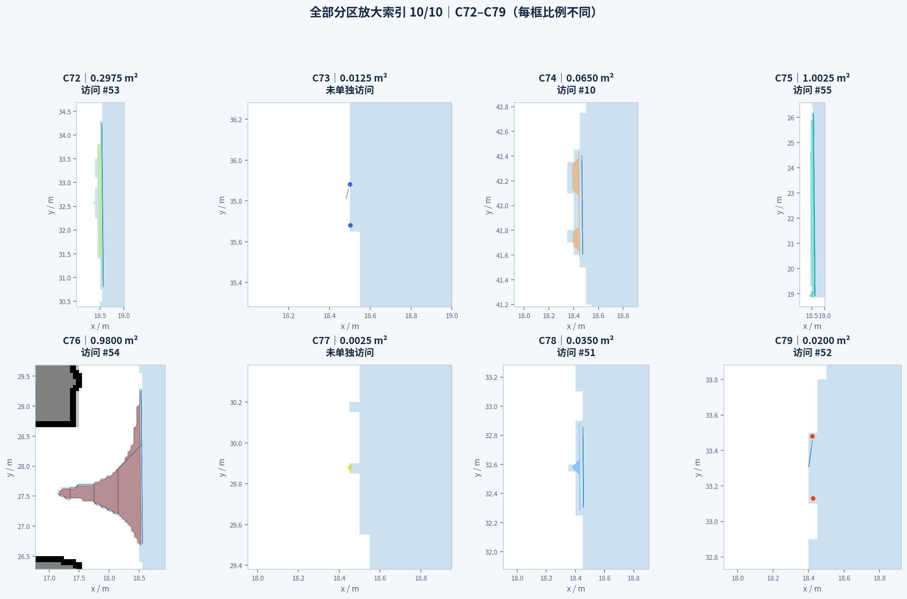

### 展开全部 80 张三联放大图入口

[C00 三联放大](assets/cells/C00.png) [C01 三联放大](assets/cells/C01.png) [C02 三联放大](assets/cells/C02.png) [C03 三联放大](assets/cells/C03.png) [C04 三联放大](assets/cells/C04.png) [C05 三联放大](assets/cells/C05.png) [C06 三联放大](assets/cells/C06.png) [C07 三联放大](assets/cells/C07.png) [C08 三联放大](assets/cells/C08.png) [C09 三联放大](assets/cells/C09.png) [C10 三联放大](assets/cells/C10.png) [C11 三联放大](assets/cells/C11.png) [C12 三联放大](assets/cells/C12.png) [C13 三联放大](assets/cells/C13.png) [C14 三联放大](assets/cells/C14.png) [C15 三联放大](assets/cells/C15.png) [C16 三联放大](assets/cells/C16.png) [C17 三联放大](assets/cells/C17.png) [C18 三联放大](assets/cells/C18.png) [C19 三联放大](assets/cells/C19.png) [C20 三联放大](assets/cells/C20.png) [C21 三联放大](assets/cells/C21.png) [C22 三联放大](assets/cells/C22.png) [C23 三联放大](assets/cells/C23.png) [C24 三联放大](assets/cells/C24.png) [C25 三联放大](assets/cells/C25.png) [C26 三联放大](assets/cells/C26.png) [C27 三联放大](assets/cells/C27.png) [C28 三联放大](assets/cells/C28.png) [C29 三联放大](assets/cells/C29.png) [C30 三联放大](assets/cells/C30.png) [C31 三联放大](assets/cells/C31.png) [C32 三联放大](assets/cells/C32.png) [C33 三联放大](assets/cells/C33.png) [C34 三联放大](assets/cells/C34.png) [C35 三联放大](assets/cells/C35.png) [C36 三联放大](assets/cells/C36.png) [C37 三联放大](assets/cells/C37.png) [C38 三联放大](assets/cells/C38.png) [C39 三联放大](assets/cells/C39.png) [C40 三联放大](assets/cells/C40.png) [C41 三联放大](assets/cells/C41.png) [C42 三联放大](assets/cells/C42.png) [C43 三联放大](assets/cells/C43.png) [C44 三联放大](assets/cells/C44.png) [C45 三联放大](assets/cells/C45.png) [C46 三联放大](assets/cells/C46.png) [C47 三联放大](assets/cells/C47.png) [C48 三联放大](assets/cells/C48.png) [C49 三联放大](assets/cells/C49.png) [C50 三联放大](assets/cells/C50.png) [C51 三联放大](assets/cells/C51.png) [C52 三联放大](assets/cells/C52.png) [C53 三联放大](assets/cells/C53.png) [C54 三联放大](assets/cells/C54.png) [C55 三联放大](assets/cells/C55.png) [C56 三联放大](assets/cells/C56.png) [C57 三联放大](assets/cells/C57.png) [C58 三联放大](assets/cells/C58.png) [C59 三联放大](assets/cells/C59.png) [C60 三联放大](assets/cells/C60.png) [C61 三联放大](assets/cells/C61.png) [C62 三联放大](assets/cells/C62.png) [C63 三联放大](assets/cells/C63.png) [C64 三联放大](assets/cells/C64.png) [C65 三联放大](assets/cells/C65.png) [C66 三联放大](assets/cells/C66.png) [C67 三联放大](assets/cells/C67.png) [C68 三联放大](assets/cells/C68.png) [C69 三联放大](assets/cells/C69.png) [C70 三联放大](assets/cells/C70.png) [C71 三联放大](assets/cells/C71.png) [C72 三联放大](assets/cells/C72.png) [C73 三联放大](assets/cells/C73.png) [C74 三联放大](assets/cells/C74.png) [C75 三联放大](assets/cells/C75.png) [C76 三联放大](assets/cells/C76.png) [C77 三联放大](assets/cells/C77.png) [C78 三联放大](assets/cells/C78.png) [C79 三联放大](assets/cells/C79.png)

## 每张图对应哪个实际源码和证据

本次先核对历史输入、结果、原生证据及当前规划源码的 SHA-256，再从既有生成副本构建**只增加记录**的追踪程序。追踪程序的 80 个轮廓和全部 46,243 个原生目标点，与历史 `output.json` 逐值相同，序列化 SHA 也一致。最终路线没有重新规划；本次重新计算指标、重放全部目标和每轮候选选择。

| 阶段 | 源文件及关键入口 |
| --- | --- |
| 输入筛选、净空与起点 | map_io.py ：load_map |
| 全局/局部方向 | room_rotator.cpp ：computeRoomMainDirection、computeRoomRotationMatrix、rotateRoom |
| 分解与区内扫线 | boustrophedon_explorator.cpp ：233 行旋转分解、263 行扫描切割、490 行标签、567 行合并规则、710 行区内扫线、966 行路径采样 |
| 区域面积与中心 | boustrophedon_explorator.h ：GeneralizedPolygon |
| 扫线网格 | grid.h ：generateBoustrophedonGrid，259 行起 |
| 实际调用与生成修改 | native/main.cpp ：31 行分解、38 行单 cell 扫线； build.py ：只改生成副本 |
| 裁剪、调度与路线记账 | planner.py ：SafeRoute、candidates、_entry_options、_plan； grid_connector.py ：GridConnector |
| 几何与覆盖指标 | metrics.py 、 ipa_connection.py 、 ipa_audit.py |

[全部分区 CSV](cells.csv)[精确数量与指标](summary.json)[完整原生中间追踪](evidence/native_trace/trace.json)[61 轮候选路径与代价](evidence/schedule_candidates.json)[本次重放核验](evidence/report_verification.json)[追踪输出一致性](evidence/native_trace/verification.json)[历史最终路线与逐段来源](../hybrid-local-bcd-2026-10-30/A11123AJ04_231127_094529_ipa_bcd.json)

离线打开本目录的 `report.html` 即可查看图表，无 CDN 或外部网络依赖。正文、图片与交互数据都在报告目录内；源码和历史结果链接还需要原项目的相对目录。重新执行脚本需要本地原 PNG 和既有历史证据路径。

```text
python3 docs/benchmarks/ipa-bcd-aj04-walkthrough-2026-11-02/trace_native.py
python3 docs/benchmarks/ipa-bcd-aj04-walkthrough-2026-11-02/prepare_report.py
python3 docs/benchmarks/ipa-bcd-aj04-walkthrough-2026-11-02/render_figures.py
python3 docs/benchmarks/ipa-bcd-aj04-walkthrough-2026-11-02/assemble_report.py
python3 docs/benchmarks/ipa-bcd-aj04-walkthrough-2026-11-02/verify_report.py
```

报告保留原输入 SHA：`88ce806ef09044c2b57ba86e7dc3befab7a177b8a07690899900fc4ffca2b016`。显示坐标保留原始浮点值；静态图片为渲染展示，精确几何以 JSON 与掩膜为准。区域颜色只用于识别，不表示语义房间或规划优劣。
