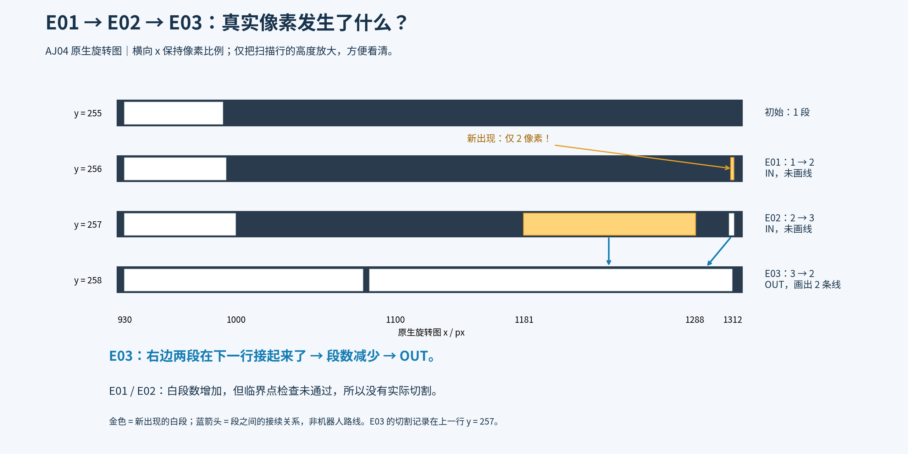
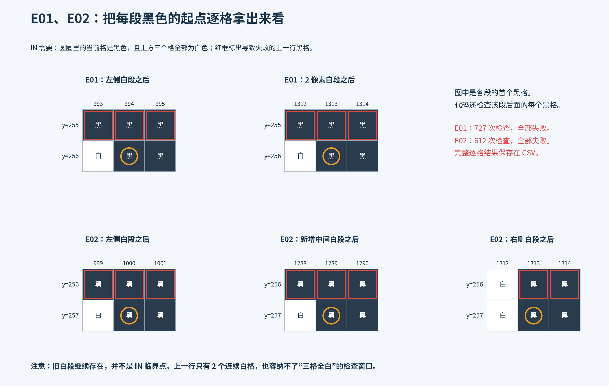
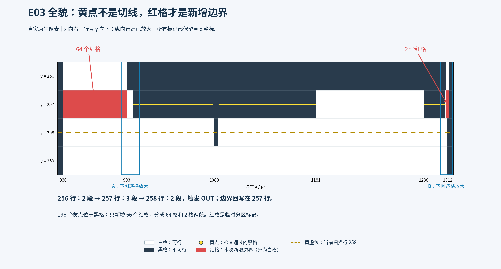
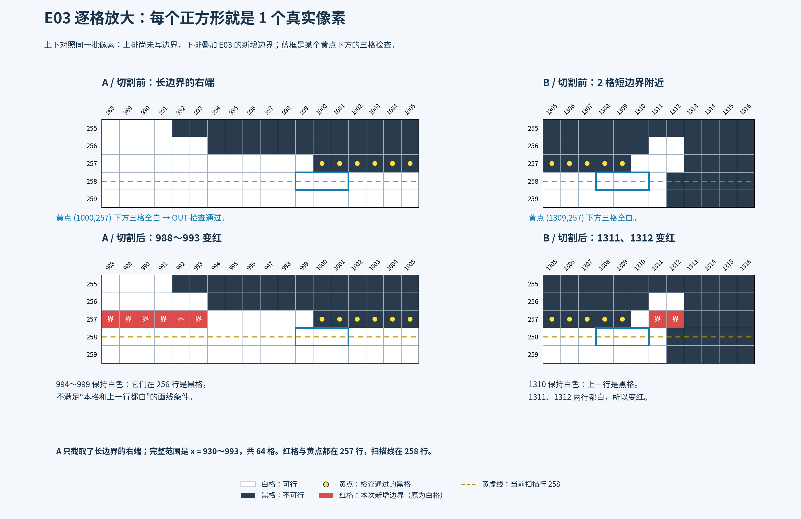

# E01～E03：从扫描行到分界线，逐步拆解

**[▶ 打开 22 步逐格动画教学（点“下一步”）](bcd-pixel-lesson.html)**

本页只讲 AJ04 的前三个事件。全部坐标来自原生旋转图：x 向右，y 行号向下。图上的“当前行”是算法正在读的一行，不是机器人运动轨迹。图可单独打开同名 SVG 放大。

## 先分清三个判断，后面每一步都按这个顺序

1. **段数判断**：这一行有几段连续白色？和上一行比较，增加就进入 IN 分支，减少就进入 OUT 分支。它只是决定是否启动检查。
2. **临界点判断**：IN 检查当前行黑格上方的三个格；OUT 检查上一行黑格下方的三个格。三个必须全部为白，才算通过。黄点标在通过的黑格上。
3. **画线判断**：通过后沿该行向左右走，遇黑即停。沿途只有“本格与参考行对应格均白”才标为边界；本格白但参考行黑时跳过，继续往前。对 IN，参考行是当前行的上一行；对 OUT，画线行是上一行，参考行则是再上一行。

**段数变化、黄点通过、红线新增，是三个不同结果，不能直接画等号。**

算法有两张图：`room_map` 是不变的原始二值输入，负责数段和检查邻格；`cell_map` 是副本，负责写临时分界线。画出的边界不会反过来改变下一行的原始白段计数。

## 0．E01 之前：先知道扫描到了哪里

第一条有白格的行是 y=203，初始为 1 段。接着逐行扫描，到 y=255 仍只有 1 段，没有产生此前的 IN/OUT 事件，也没有此前画下的切线。

以下范围全部包含左右端点：

| 行号 | 白色连续段的 x 范围 | 段数 |
| --- | --- | --- |
| 255 | 930～991 | 1 |
| 256 | 930～993；1311～1312 | 2 |
| 257 | 930～999；1181～1288；1310～1312 | 3 |
| 258 | 930～1079；1084～1311 | 2 |



## 1．E01：扫描到 y=256

### 1.1 数白段：1 → 2，所以进入 IN 分支

上一行只有左侧 930～991。当前行左段扩展到 930～993，远右侧又扫到 1311、1312 两个白格。新增的是右侧一段，整行白段数量增加到 2。

### 1.2 从左向右找当前行黑格

代码先略过左侧尚未遇到白格的黑色背景，遇到第一个白格 x=930 后，检查此后的每个黑格，不是只检查各黑段的第一个格。

本行被检查的黑格范围为 994～1310 和 1313～1722，共 727 格。对每一个黑格 x，都看上一行 y=255 的 x−1、x、x+1。

### 1.3 代表位置逐格代入

| 当前黑格 | 上一行检查的三个 x | 实际像素 | 结果 |
| --- | --- | --- | --- |
| (994,256) | 993、994、995 | 黑、黑、黑 | 失败 |
| (1313,256) | 1312、1313、1314 | 黑、黑、黑 | 失败 |

为什么能确定整段没有遗漏的通过点？上一行只有 930～991 为白。要放下连续三个白格，中心 x 必须位于 931～990；但这些位置在当前行全是白格，不属于被检查的黑格。因此不存在“当前黑格＋上方三格全白”的组合。

### 1.4 E01 结束

727 个黑格全部检查失败，黄点 0 个、边界 0 格。代码保存“本行有 2 段”，然后继续扫下一行。这里的 IN 是进入了一次检查分支，未实际切割。

## 2．E02：扫描到 y=257

### 2.1 数白段：2 → 3，再次进入 IN 分支

左段变成 930～999；新增中间段 1181～1288；右侧原来的两格白色扩展为 1310～1312。注意：右侧从两格变成三格仍是一段，**这次段数增加来自中间段出现**。

### 2.2 检查当前黑格上方的三个位置

当前行被检查的黑格为 1000～1180、1289～1309、1313～1722，共 612 格；参考上一行 y=256。

| 当前黑格 | 上一行检查的三个 x | 实际像素 | 结果 |
| --- | --- | --- | --- |
| (1000,257) | 999、1000、1001 | 黑、黑、黑 | 失败 |
| (1289,257) | 1288、1289、1290 | 黑、黑、黑 | 失败 |
| (1313,257) | 1312、1313、1314 | 白、黑、黑 | 失败 |

### 2.3 为什么 E01 的两个白格不能让 E02 画线？

```text
x →         1310  1311  1312  1313  1314
y=256：      黑    白    白    黑    黑
y=257：      白    白    白    黑    黑
                              ↑ 当前黑格 1313
```

旧白格 1311、1312 在当前行还是白格，不是 IN 要检查的黑格。当前黑格 1313 上面的三个位置是“白、黑、黑”，不是全白。并且上一行这个白段总共只有两格，不论窗口放在哪里，都不可能形成“三格全白”。

对左侧也可完整判断：上一行的长白段为 930～993，三格全白窗口的中心只能在 931～992；这些中心位置在当前行也全是白。因此整行没有遗漏的通过点。

### 2.4 E02 结束

612 个黑格全部失败，黄点 0 个、边界 0 格。保存“本行有 3 段”，再往下扫描。



[放大上述像素图 SVG](assets/20_e01_e02_failed_checks.svg)。该图展示各黑段首格；完整 CSV 记录了两次事件全部 1339 个黑格检查，而非仅这些代表点。

## 3．E03：扫描到 y=258

### 3.1 数白段：3 → 2，进入 OUT 分支

y=257 的中间白段 1181～1288、右侧白段 1310～1312，都接到 y=258 的右白段 1084～1311，右侧两段汇合。左侧也扩展为 930～1079，但和右侧之间仍隔着 1080～1083 四个黑格。因此整行总数是 2 段。

**整行段数减少，只负责触发 OUT。进入该分支后，代码会检查上一行的全部候选黑格，并不限于刚发生汇合的右侧。**这是左侧也会产生红线的关键。

### 3.2 回到上一行 y=257，逐个检查黑格

仍是 1000～1180、1289～1309、1313～1722，共 612 个黑格。但这次看的是它们下方 y=258 的三个位置，不再看上方 y=256。

| y=257 的黑格范围 | y=258 下方三格 | 通过数量 |
| --- | --- | --- |
| 1000～1078 | 全白 | 79 |
| 1079～1084 | 窗口会碰到 1080～1083 的黑格 | 0 |
| 1085～1180 | 全白 | 96 |
| 1289～1309 | 全白 | 21 |
| 1313～1722 | 不是全白 | 0 |

合计 79＋96＋21＝196 个黄点。它们本身仍是原来的黑格，没有被改成自由空间。

### 3.3 每个黄点都向左右试着延伸，但不会都产生红线

对 OUT，延伸在 y=257 上进行。遇 y=257 黑格立刻停；遇白格，再检查 y=256 同一个 x 是否也白：两行都白才标红，否则跳过该白格并继续走。

本事件有 196×2＝392 次左右延伸。388 次第一步就遇黑格，立刻停止；只有下面 4 次能走到白格。

| 起点黄格 | 方向 | 遇到的白格及处理 | 最终新增边界 |
| --- | --- | --- | --- |
| (1000,257) | 左 | 999～994 上一行黑，跳过；993～930 两行均白，标红；929 黑，停止 | 930～993，共 64 格 |
| (1180,257) | 右 | 1181～1288 当前白、上一行全黑，108 格全部跳过；1289 黑，停止 | 0 格 |
| (1289,257) | 左 | 1288～1181 当前白、上一行全黑，108 格全部跳过；1180 黑，停止 | 0 格 |
| (1309,257) | 右 | 1310 上一行黑，跳过；1311、1312 两行均白，标红；1313 黑，停止 | 1311～1312，共 2 格 |

“跳过”不是删掉像素，也不是停止延伸，仅表示该格不标为边界，继续检查下一个位置。

例如第一个黄点 x=1000，左边紧邻的是 y=257 的白格 999，所以可以继续走；但它上面 y=256 的 999 是黑格，不能标红。直到走到 993，才第一次满足“两行都白”。这就是为什么红线与黄点之间会留着 994～999 六个白格。

**本次并没有靠“很多黄点画线重合”得到两段红线。完整重放确认只有黄点 1000 的向左延伸和黄点 1309 的向右延伸新增了边界。**先前把重合作为解释不适用于这一次，以上逐点记录为准。





### 3.4 E03 结束时，究竟改了什么？

cell_map 的 y=257 被新增两段临时边界：930～993 的 64 格、1311～1312 的 2 格，共 66 格。原始 room_map 没改；扫描器保存原始 y=258 的 2 段继续往下扫描。下一行 y=259 为 1 段，那是 E04 的下一次 OUT，不属于 E03。

E03 的两段边界不直接等于“新增两个最终分区”。要等全图所有事件处理完，才能对 cell_map 做四连通标号，得到最终 80 个 cell。

## 对照图例，避免再把三种标记混在一起

| 标记 | 位置与意义 | 是否改变原图自由/障碍性质 |
| --- | --- | --- |
| 黄虚线 | 当前扫描行 y=258 | 否，只是定位线 |
| 黄点 | y=257 上通过三格检查的黑格 | 否，只是可视化标记 |
| 红格 | cell_map 中新增的临时分界像素，原来是白格 | 仅供分区标号，不是移动障碍墙 |

## 完整证据与复现

本页展示关键步骤和同类项分组，没有把两千次重复检查逐条排进正文。全部检查记录均保留，可按 x 查任何一个像素。

- [全部 1951 次黑格邻域检查 CSV](evidence/e01_e03_all_pixel_checks.csv)：每条包括事件、行号、x、三邻格值及是否通过；0 是黑，255 是白。
- [全部 392 次左右延伸 CSV](evidence/e01_e03_all_border_rays.csv)：包括每次标红范围、跳过白格、停止位置与原因。
- [逐事件独立重放核对 JSON](evidence/e01_e03_step_audit.json)：临界点列表与边界像素逐格匹配原生证据。
- [原生算法源码](../../../third_party/ipa_coverage_planning/ipa_room_exploration/common/src/boustrophedon_explorator.cpp)：computeCellDecomposition 的 IN/OUT 分支。

```bash
python3 docs/benchmarks/ipa-bcd-aj04-walkthrough-2026-11-02/explain_e01_e03.py
```

本补充没有改动原报告 HTML 的交互、规划器、上游或历史规划结果。
