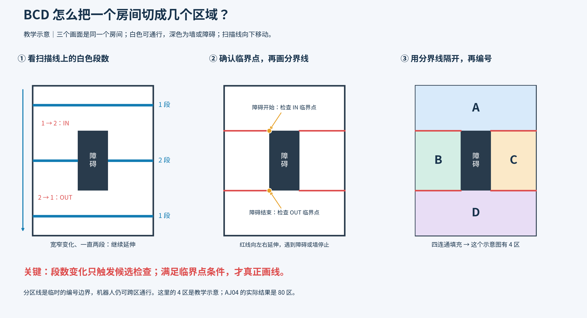
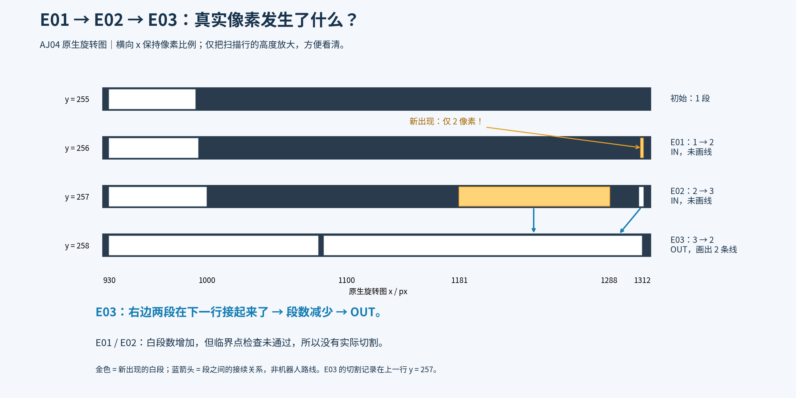
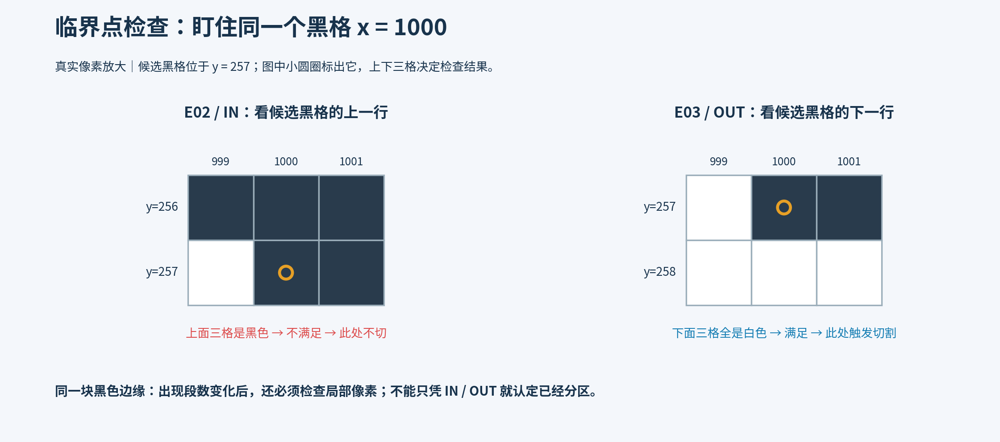
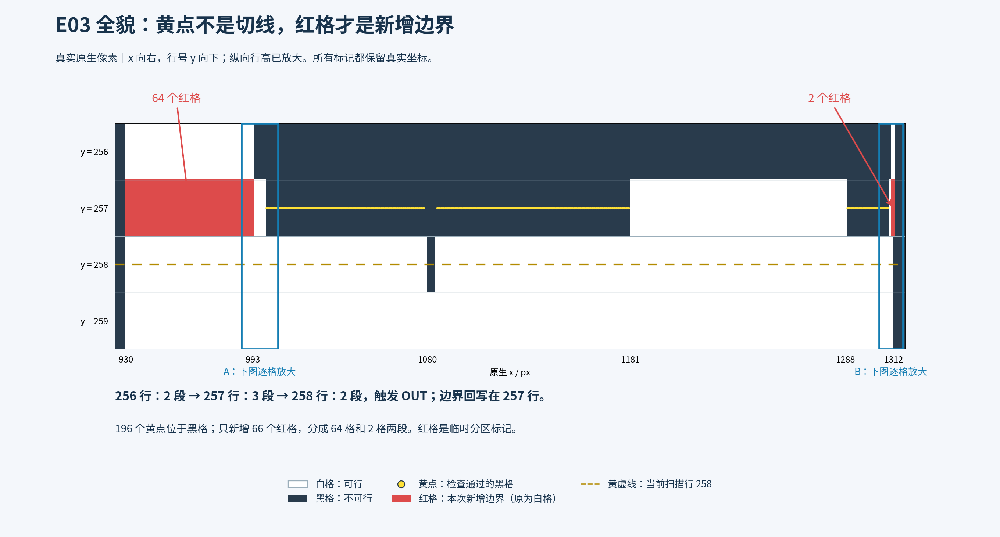
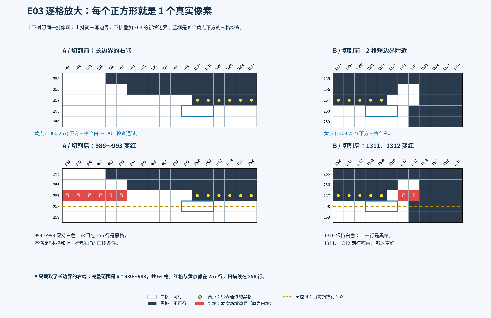

# IPA BCD 分区逻辑图解

**[▶ 先看四个简单场景：从扫描到最后分区](simple-scenes/index.html)**

**[▶ 打开 E01～E03 逐格动画教学](bcd-pixel-lesson.html)**

E01～E03 的全部逐步执行解释见[独立网页](e01-e03-walkthrough.html)或[Markdown 完整拆解](e01-e03-walkthrough.md)，含全部黑格检查/左右延伸 CSV；本页保留图解索引。

先看教学图：同一个带障碍的房间，扫描线向下移动，白色段数从 1 变成 2，再变回 1；检查临界点、画临时分界线后，以四连通填充形成 A/B/C/D 四区。这是教学示意，不是 AJ04 的实际分区数量。



再看 AJ04 的真实扫描行：E01 为 1→2，E02 为 2→3，E03 为 3→2。前两次没有临界点和实际切割；E03 在上一行写入两段切割像素。横向保持真实像素比例，只放大了行高。



同一个黑格 `(1000,257)`：在 E02 检查上一行三个位置时是黑色，不满足 IN 临界点条件；E03 检查下一行三个位置时全白，满足 OUT 临界点条件。该点示范一次局部检查；整条扫描行还会继续检查其他黑格。



## E03 的黄点、扫描行与红色边界

总览按原生坐标展示：黄虚线是当前扫描行 258，黄点是上一行 257 检查通过的黑格，红格是写在 257 行的临时分区边界。纵向行高已放大；A/B 蓝框对应下一张逐格图。



逐格图中每个正方形是一个真实像素；上排切割前，下排切割后，坐标和像素比例完全一致。蓝色三格框用于判断 OUT 临界点，红色边界则另外要求目标格及其上一行都白。因此 A 中 994～999 保持白色；B 中 1310 保持白色，只有 1311、1312 被标红。A 只显示 64 格长边界的右端，完整长边界是 930～993。



可放大矢量图：[像素总览 SVG](assets/18_e03_pixel_overview.svg)、[逐格对照 SVG](assets/19_e03_pixel_before_after.svg)。本次逐事件重放确认 196 个临界黑格、66 个新增边界像素（64＋2），与原生记录完全一致；检查点与边界不代表机器人路径。核对摘要见 `evidence/e03_pixel_verification.json`。

每张图都有同名 SVG，可在支持 SVG 的查看器中放大。复现命令（项目根目录）：

```bash
python3 docs/benchmarks/ipa-bcd-aj04-walkthrough-2026-11-02/draw_partition_explanation.py
python3 docs/benchmarks/ipa-bcd-aj04-walkthrough-2026-11-02/draw_e03_pixels.py
```

生成器直接读取原生旋转掩膜与追踪 JSON，核对真实白色段、E01～E03 类型及切割、局部像素，以及教学图四连通区域数量。核对摘要见 `evidence/partition_explanation.json`。本补充未修改 HTML、规划器或历史规划结果。
