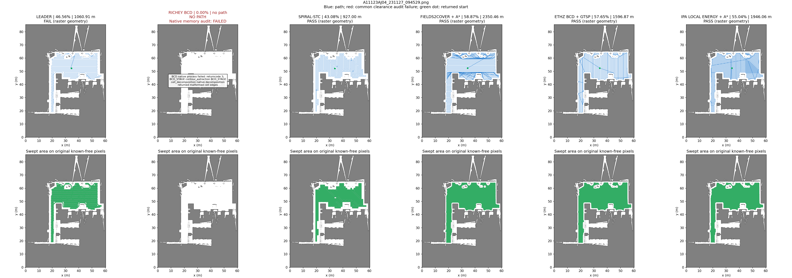
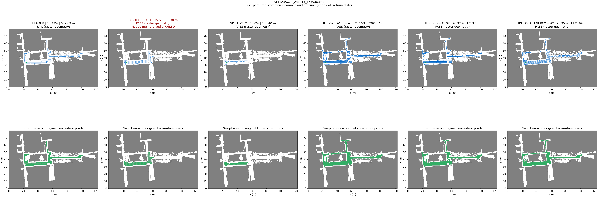
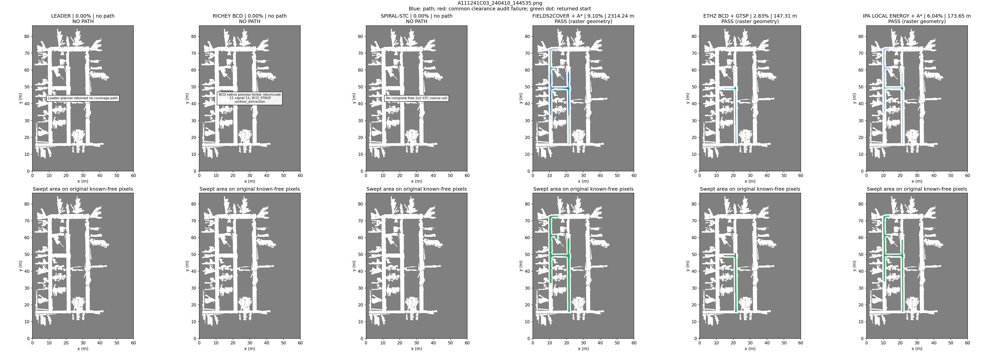

# 六算法同图对比：新增 IPA Grid Local Energy＋A*

2026-10-30。IPA在原三张PNG实际运行，另外五种复用历史完整路线并统一复算；只规划，不启动仿真或运动。

## 三项指标

| 场景 | 算法／完整路线 | 覆盖率 | 完整路径长度 | 栅格几何有效性 |
| --- | --- | ---: | ---: | --- |
| AJ04 | [Leader](../three-planners-2026-10-27/A11123AJ04_231127_094529_leader.json) | 46.56% | 1,060.91 m | 未通过 |
| AJ04 | [Richey BCD](../three-planners-2026-10-27/A11123AJ04_231127_094529_bcd.json) | 0.00% | —（无路径） | 失败 |
| AJ04 | [Spiral-STC](../three-planners-2026-10-27/A11123AJ04_231127_094529_stc.json) | 43.08% | 927.00 m | 通过 |
| AJ04 | [Fields2Cover + A*](../f2c-obstacle-2026-10-28/A11123AJ04_231127_094529_safe.json) | 58.87% | 2,350.46 m | 通过 |
| AJ04 | [ETHZ BCD + GTSP](../five-planners-2026-10-29/A11123AJ04_231127_094529_ethz.json) | 57.65% | 1,596.87 m | 通过 |
| AJ04 | [IPA Local Energy + A*](A11123AJ04_231127_094529_ipa_safe.json) | 55.04% | 1,946.06 m | 通过 |
| AC22 | [Leader](../three-planners-2026-10-27/A11123AC22_231213_163036_leader.json) | 18.49% | 607.63 m | 未通过 |
| AC22 | [Richey BCD](../three-planners-2026-10-27/A11123AC22_231213_163036_bcd.json) | 12.15% | 525.38 m | 通过（原生内存缺陷） |
| AC22 | [Spiral-STC](../three-planners-2026-10-27/A11123AC22_231213_163036_stc.json) | 6.80% | 185.40 m | 通过 |
| AC22 | [Fields2Cover + A*](../f2c-obstacle-2026-10-28/A11123AC22_231213_163036_safe.json) | 31.16% | 3,961.54 m | 通过 |
| AC22 | [ETHZ BCD + GTSP](../five-planners-2026-10-29/A11123AC22_231213_163036_ethz.json) | 26.32% | 1,313.23 m | 通过 |
| AC22 | [IPA Local Energy + A*](A11123AC22_231213_163036_ipa_safe.json) | 26.35% | 1,171.99 m | 通过 |
| C03 | [Leader](../three-planners-2026-10-27/A111241C03_240410_144535_leader.json) | 0.00% | —（无路径） | 失败 |
| C03 | [Richey BCD](../three-planners-2026-10-27/A111241C03_240410_144535_bcd.json) | 0.00% | —（无路径） | 失败 |
| C03 | [Spiral-STC](../three-planners-2026-10-27/A111241C03_240410_144535_stc.json) | 0.00% | —（无路径） | 失败 |
| C03 | [Fields2Cover + A*](../f2c-obstacle-2026-10-28/A111241C03_240410_144535_safe.json) | 9.10% | 2,314.24 m | 通过 |
| C03 | [ETHZ BCD + GTSP](../five-planners-2026-10-29/A111241C03_240410_144535_ethz.json) | 2.83% | 147.31 m | 通过 |
| C03 | [IPA Local Energy + A*](A111241C03_240410_144535_ipa_safe.json) | 6.04% | 173.65 m | 通过 |

[CSV](summary.csv) · [输入/源码/依赖指纹](manifest.json) · [独立复核](verification.json)

## 同图完整轨迹与扫掠

### A11123AJ04_231127_094529.png



### A11123AC22_231213_163036.png



### A111241C03_240410_144535.png



## 同一输入与安全处理

- 原图、阈值、float32的0.05 m分辨率、公共起点、0.6 m作业宽度与1 m中心净空与旧实验逐项核对；所有路线均以原图全部自由像素为覆盖分母，只列三项指标。
- IPA固定算法6的原生房间旋转、能量评分和完整目标顺序；输入为公共起点的四邻接净空分量。上游半格内缩保留，因此有额外内部预处理，不宣称各实现内部有效范围相同。
- 覆盖半径0.3 m；原生格距为0.3×sqrt(2) m，并在内部按像素取整。输入像素索引通过半格平移映射到共同像素中心，无地图裁剪/缩放或输出点移动。
- 自有连接层从公共起点开始，按原顺序保留每一个原生目标。直线检查通过则保留，否则在共同原分辨率净空图上无切角A*；所有连接和起点接近计长，不删坏段，不要求回起点。
- 全路通过原图/1 m共同净空审计和禁止触碰障碍格边角的闭格审计；独立复核再用解析线段/阻塞像素方框相交检查。不满足任何一项即整路失败，原生数据仍保留。
- ETHZ仍保留其0.2 m保守分块和闭合回程规则；BCD额外内缩、STC粗化及Leader历史净空问题不改写。此为固定实现的端到端比较，长度需连同覆盖率/范围/起终点读取。
- 仅保证已知栅格模型里的完整路线几何安全；不等同全图完成、动态避障、曲率/动力学或真机能力。

## 原生Local Energy诊断

以下仅用于揭示原生访问序列，未进入六算法主排名；没有把无效线段删除后冒充原生成功。

| 场景 | 原生目标数 | 原生直接连线覆盖率 | 原生直接连线长度 | 原生直接连线有效性 | A*连接数 |
| --- | ---: | ---: | ---: | --- | ---: |
| A11123AJ04 | 4329 | 55.60% | 1918.32 m | 未通过 | 10 |
| A11123AC22 | 2550 | 27.33% | 1143.03 m | 未通过 | 11 |
| A111241C03 | 212 | 5.65% | 142.28 m | 未通过 | 4 |

## 可溯源与复现

固定上游 `ipa320/ipa_coverage_planning@986c18384ed884dadd3bc857cd0c47c13b7d4716`；只读原文件，薄ROS消息/日志兼容与明确拒绝FOV模式的接口位于自有 `ipa_native/`。manifest绑定原图、共同栅格、实际编译源码/头、编译器、可执行文件、动态库和逐段来源。上游许可声明含学术/非商业用途限制，保留原声明。

```bash
git submodule update --init third_party/ipa_coverage_planning
python3 -m coverage_benchmark.adapters.ipa_build
python3 -m coverage_benchmark.ipa_compare --output docs/benchmarks/six-planners-local
python3 -m coverage_benchmark.verify_ipa --output docs/benchmarks/six-planners-local
```

复现限制：已指纹化项目源码、选定上游头、编译器、实际二进制和当前解析的动态库；OpenCV/Eigen等系统开发头未逐个独立指纹化，跨机器重建仍需核对开发环境。

首次构建需要g++、pkg-config、OpenCV4和Eigen3开发头；仍需本地三张PNG及既有五算法证据。`--reuse`只复算已保存IPA，不重跑规划；另设output保留本次基线。
