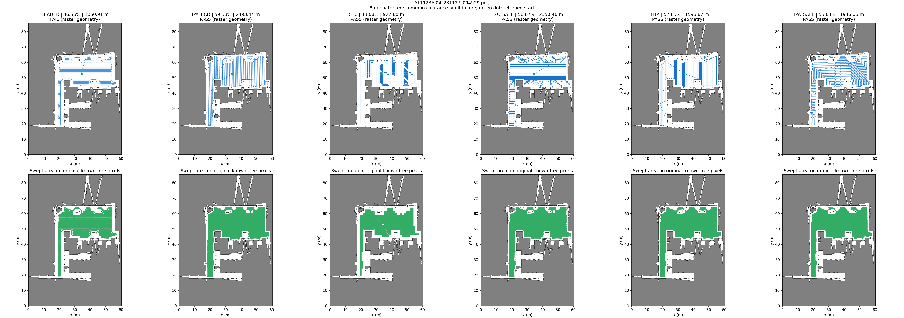
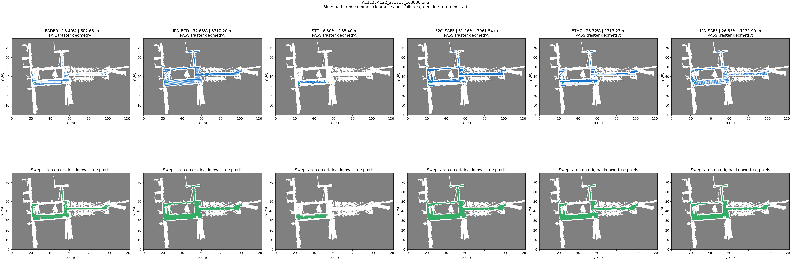
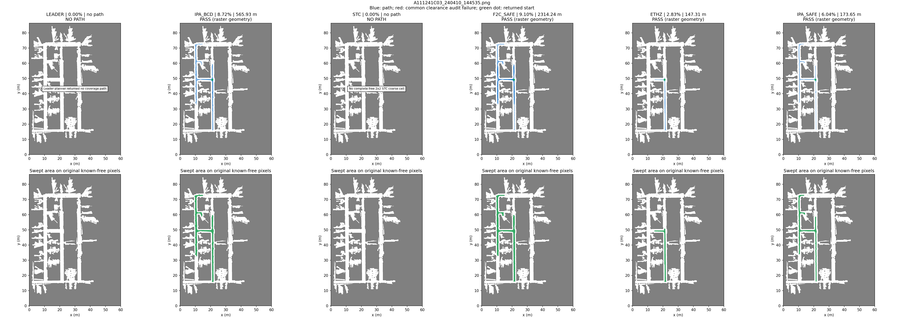

# 六算法全量重跑：BCD 已替换为 IPA BCD

2026-11-03，原三图 × 当前六算法共 **18 组，全部真实重新调用规划器**，没有读取旧路线代替本次运行。旧 Richey BCD、BCD_LOCAL、HYBRID_LOCAL 不参与本轮。仅启动隔离规划服务，不运行 Gazebo、导航执行或机器人运动。

**网页入口：[report.html](report.html)** · [三项指标 CSV](summary.csv) · [运行/源码/原生证据指纹](manifest.json) · [独立复核](verification.json)

## 三项指标

覆盖分母为原图全部已知自由像素；失败返回空路线，长度记缺失。路径不通过安全检查时，扫掠率只表示几何名义值，不能视为可执行覆盖。

| 地图 | 算法／完整路线 | 覆盖率 | 完整返回路径长度 | 共同栅格几何有效性 |
| --- | --- | ---: | ---: | --- |
| A11123AJ04 | [Leader](A11123AJ04_231127_094529_leader.json) | 46.5613% | 1,060.91 m | 不通过（名义覆盖率） |
| A11123AJ04 | [IPA BCD＋安全连接](A11123AJ04_231127_094529_ipa_bcd.json) | 59.3848% | 2,493.44 m | 通过 |
| A11123AJ04 | [Spiral-STC](A11123AJ04_231127_094529_stc.json) | 43.0781% | 927.00 m | 通过 |
| A11123AJ04 | [Fields2Cover＋安全连接](A11123AJ04_231127_094529_f2c_safe.json) | 58.8749% | 2,350.46 m | 通过 |
| A11123AJ04 | [ETHZ BCD＋GTSP](A11123AJ04_231127_094529_ethz.json) | 57.6468% | 1,596.87 m | 通过 |
| A11123AJ04 | [IPA Local Energy＋A*](A11123AJ04_231127_094529_ipa_safe.json) | 55.0446% | 1,946.06 m | 通过 |
| A11123AC22 | [Leader](A11123AC22_231213_163036_leader.json) | 18.4931% | 607.63 m | 不通过（名义覆盖率） |
| A11123AC22 | [IPA BCD＋安全连接](A11123AC22_231213_163036_ipa_bcd.json) | 32.6348% | 3,210.20 m | 通过 |
| A11123AC22 | [Spiral-STC](A11123AC22_231213_163036_stc.json) | 6.8023% | 185.40 m | 通过 |
| A11123AC22 | [Fields2Cover＋安全连接](A11123AC22_231213_163036_f2c_safe.json) | 31.1626% | 3,961.54 m | 通过 |
| A11123AC22 | [ETHZ BCD＋GTSP](A11123AC22_231213_163036_ethz.json) | 26.3248% | 1,313.23 m | 通过 |
| A11123AC22 | [IPA Local Energy＋A*](A11123AC22_231213_163036_ipa_safe.json) | 26.3451% | 1,171.99 m | 通过 |
| A111241C03 | [Leader](A111241C03_240410_144535_leader.json) | 0.0000% | — | 规划失败 |
| A111241C03 | [IPA BCD＋安全连接](A111241C03_240410_144535_ipa_bcd.json) | 8.7178% | 565.93 m | 通过 |
| A111241C03 | [Spiral-STC](A111241C03_240410_144535_stc.json) | 0.0000% | — | 规划失败 |
| A111241C03 | [Fields2Cover＋安全连接](A111241C03_240410_144535_f2c_safe.json) | 9.1025% | 2,314.24 m | 通过 |
| A111241C03 | [ETHZ BCD＋GTSP](A111241C03_240410_144535_ethz.json) | 2.8335% | 147.31 m | 通过 |
| A111241C03 | [IPA Local Energy＋A*](A111241C03_240410_144535_ipa_safe.json) | 6.0414% | 173.65 m | 通过 |

## 同图完整轨迹与扫掠

上排：完整返回路径，蓝色通过共同净空检查、红色不通过，绿点为返回起点。下排：工具圆盘扫掠与原图自由像素的交集。各列统一坐标、范围与像素尺度。图可单独打开缩放。

### A11123AJ04_231127_094529



### A11123AC22_231213_163036



### A111241C03_240410_144535



## 输入与实现边界

- 同三张原 PNG、阈值、0.05 m/像素（内部与既有管线一致转换为 float32）、公共请求起点、0.6 m 作业宽度、1 m 中心净空。原图全体自由像素为分母；净空外、起点不可达或内部预处理排除的区域仍计未覆盖。
- IPA BCD 直接调用固定 IPA 的分解及单 cell 扫线；项目层裁剪安全候选、按安全连接距离贪心调度并连接。不是旧 Richey BCD。这个适配关闭额外半格腐蚀，不调用 Local、不做补扫。
- IPA Local Energy 使用原有算法 6 适配，保留原生额外半格内缩和访问顺序；项目层保留所有目标并加入起点接近/安全 A*。它与 BCD 的内部有效范围不同，不能只比较路线长短。
- Fields2Cover 使用原生排序扫线，项目层进行净空裁剪及安全连接；原生转弯失败时明确保留错误和已成功的原生有序扫线，不将失败曲线冒充成功。
- ETHZ 使用 0.2 m 保守全自由分块、原生 BCD/扫描/可见图/GK-MA；返回包含公共起点接近和回程的闭合路线。分块舍弃数量保存在每图 JSON。
- Leader 和 STC 使用原适配；Leader 服务返回的净空临界段按共同指标如实判定。STC 保守粗化并从最近可用粗格开始，可能失败或存在起点偏移；没有补造起点连接。下面列出实际起点偏移，不能把各算法的路径长度视为相同起终点问题的最优解。
- 长度计算包含返回路径全部相邻点连接、绕行和重复；已扫面积算并集。不保证全图覆盖、曲率/动力学可执行、动态避障或真机能力。

## 实际运行和失败细节

| 地图 | 算法 | 实际调用耗时（含适配，不含统一绘图） | 返回起点距请求起点 | 原图穿障段 | 共同净空违规段 |
| --- | --- | ---: | ---: | ---: | ---: |
| A11123AJ04 | Leader | 2.10 s | 0.2500 m | 0 | 6 |
| A11123AJ04 | IPA BCD＋安全连接 | 38.54 s | 0.0000 m | 0 | 0 |
| A11123AJ04 | Spiral-STC | 0.15 s | 0.5489 m | 0 | 0 |
| A11123AJ04 | Fields2Cover＋安全连接 | 8.60 s | 0.0000 m | 0 | 0 |
| A11123AJ04 | ETHZ BCD＋GTSP | 1.73 s | 0.0000 m | 0 | 0 |
| A11123AJ04 | IPA Local Energy＋A* | 1.54 s | 0.0000 m | 0 | 0 |
| A11123AC22 | Leader | 2.30 s | 0.1118 m | 0 | 22 |
| A11123AC22 | IPA BCD＋安全连接 | 67.59 s | 0.0000 m | 0 | 0 |
| A11123AC22 | Spiral-STC | 0.01 s | 0.4316 m | 0 | 0 |
| A11123AC22 | Fields2Cover＋安全连接 | 18.66 s | 0.0000 m | 0 | 0 |
| A11123AC22 | ETHZ BCD＋GTSP | 7.44 s | 0.0000 m | 0 | 0 |
| A11123AC22 | IPA Local Energy＋A* | 1.43 s | 0.0000 m | 0 | 0 |
| A111241C03 | Leader | 1.64 s | — | — | — |
| A111241C03 | IPA BCD＋安全连接 | 11.25 s | 0.0000 m | 0 | 0 |
| A111241C03 | Spiral-STC | 0.00 s | — | — | — |
| A111241C03 | Fields2Cover＋安全连接 | 9.12 s | 0.0000 m | 0 | 0 |
| A111241C03 | ETHZ BCD＋GTSP | 0.35 s | 0.0000 m | 0 | 0 |
| A111241C03 | IPA Local Energy＋A* | 0.45 s | 0.0000 m | 0 | 0 |

- **A11123AJ04 / Leader**：Leader planner preview generated; robot motion is not enabled；指标诊断：`{"covered_pixels": 236163, "total_free_pixels": 507209, "invalid_segments": 6, "collision_segments": 0, "invalid_length_m": 0.36213203975215214, "reason": "collision, boundary or clearance raster violation"}`。

- **A11123AC22 / Leader**：Leader planner preview generated; robot motion is not enabled；指标诊断：`{"covered_pixels": 119359, "total_free_pixels": 645425, "invalid_segments": 22, "collision_segments": 0, "invalid_length_m": 1.3278174790912245, "reason": "collision, boundary or clearance raster violation"}`。

- **A111241C03 / Leader**：Leader planner returned no coverage path；指标诊断：`{"reason": "planner failed or returned no complete path"}`。

- **A111241C03 / Spiral-STC**：No complete free 2x2 STC coarse cell；指标诊断：`{"reason": "planner failed or returned no complete path"}`。

## 复现与验证

在项目根目录、相同依赖和本地地图存在时：

```bash
# 规划脚本只接受全新输出目录，避免覆盖本次或历史结果。
# 另复制本目录三个 .py 脚本到 docs/benchmarks/<新目录>/ 后执行：
python3 docs/benchmarks/<新目录>/rerun.py
python3 docs/benchmarks/<新目录>/assemble.py
python3 docs/benchmarks/<新目录>/verify.py
```

独立复核重新检查输入/源码/依赖及全部结果/证据 SHA，重算三项指标与独立点到折线覆盖见证；对 IPA BCD 重放原生 cell 扫线、调度与连接，对 Local 重放全部目标和连接，对 F2C 重放原生条带及连接，对 ETHZ 核对完整原生闭合路径；Leader 对照服务响应、STC 确定性重放。失败保留，不要求所有规划器成功或所有返回路线有效才保存证书。适用静态栅格几何范围。

`evidence/<地图>/<算法>/` 保存本轮输入、原生输出及日志，JSON 中的原生路径指向这些文件。证据含本机绝对路径，异机应另目录重新运行。历史报告未改写。
