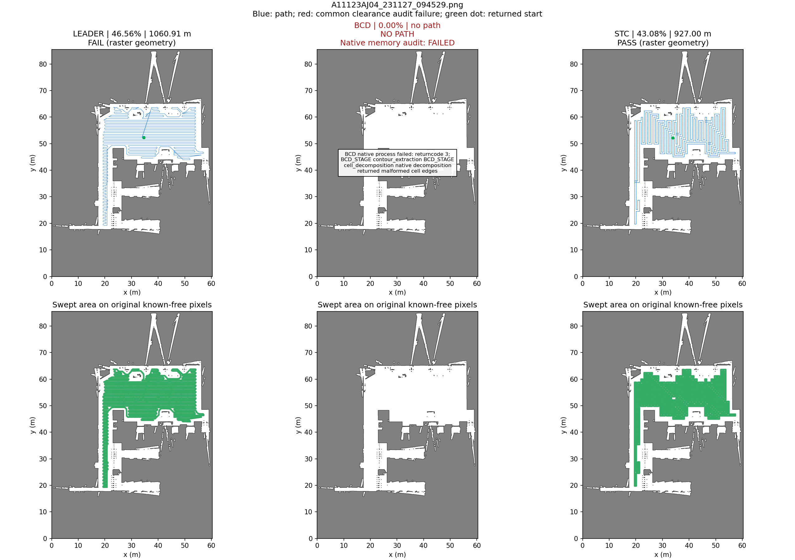
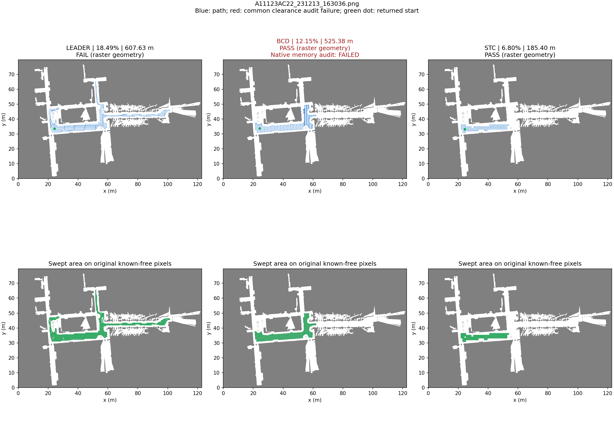
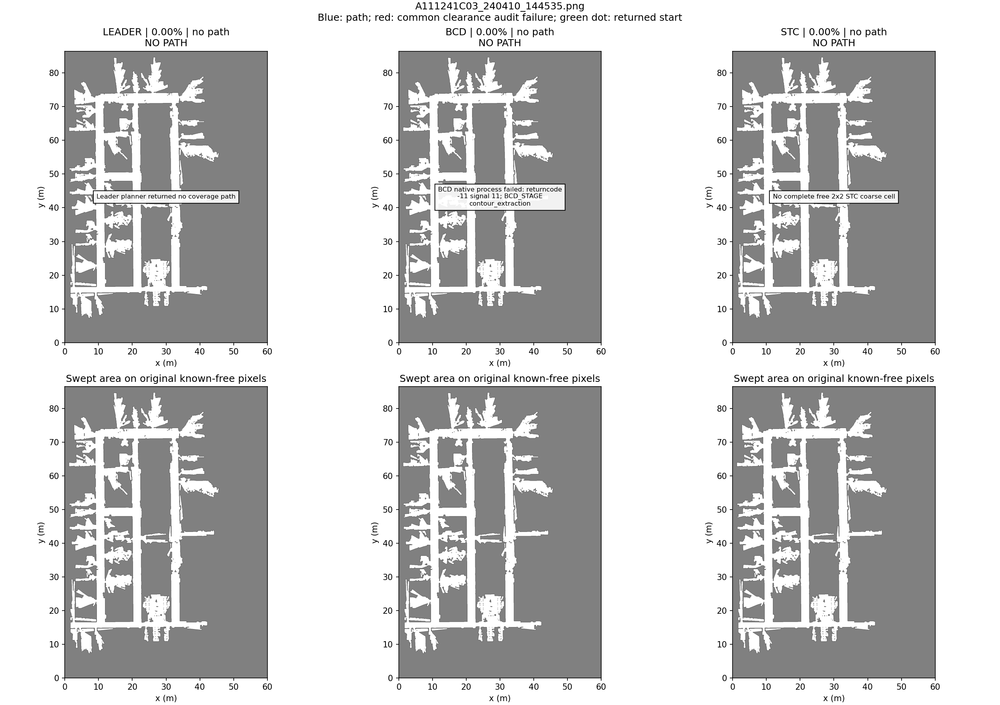

# Leader / BCD / Spiral-STC 三场景规划 benchmark

最新统一总览：[Leader / BCD / STC / Fields2Cover 修改版四算法对比](../four-planners-2026-10-28/README.md)。

2026-10-27，三算法各运行三张原始 PNG，一组一次规划。未启动 Gazebo、导航或运动。九组包含明确失败，完整世界坐标路径及失败详情均保留。仅比较覆盖率、路径长度和路径有效性。

## 指标结果

| 场景 | 算法 | 覆盖率 | 路径长度 | 路径有效性 |
| --- | --- | ---: | ---: | --- |
| AJ04 | LEADER | 46.56% | 1,060.91 m | 未通过 |
| AJ04 | BCD | 0.00% | —（无路径） | 失败 |
| AJ04 | STC | 43.08% | 927.00 m | 通过 |
| AC22 | LEADER | 18.49% | 607.63 m | 未通过 |
| AC22 | BCD | 12.15% | 525.38 m | 通过 |
| AC22 | STC | 6.80% | 185.40 m | 通过 |
| C03 | LEADER | 0.00% | —（无路径） | 失败 |
| C03 | BCD | 0.00% | —（无路径） | 失败 |
| C03 | STC | 0.00% | —（无路径） | 失败 |

**BCD 的 AC22 路径通过了几何审计，但同输入的 ASAN/UBSAN 诊断发现原生堆越界读取；不能据此推荐为稳定可用实现。** 表中“有效性”仅指保存轨迹的共同栅格几何检查。详见 [BCD 原生诊断](bcd_diagnostics.md)。

机器可读表见 [summary.csv](summary.csv)，原图和版本指纹见 [manifest.json](manifest.json)，复算证据见 [verification.json](verification.json)。所有 `<场景>_<算法>.json` 保存 `path`（米制 XY 全路径）、`planner_success`、原生参数、失败原因和三项指标；诊断不另作排名指标。

## 原图轨迹与覆盖

上排全局轨迹：蓝色为路径，红色为严格净空审计不合格段，绿点为返回路径起点。下排绿色为原图自由像素上、0.6 m 作业圆盘的几何扫掠并集。地图坐标为本轮假设的局部米制坐标。

### A11123AJ04_231127_094529.png

Leader 中心线没有穿原图非自由格，但 6 个临界短段共 0.362 m 不满足共同精确净空栅格；因此整条路径标为未通过。Spiral-STC 路径通过当前栅格审计。BCD 在原生 cell 分解阶段产生不满足后续访问前提的 cell，adapter 明确拒绝。另在仅绕过包装层检查的诊断副本中，ASAN 还证实原生 `GetBoustrophedonPath` 的独立堆越界读取；没有将未检测构建的偶然正常退出作为成功。

### A11123AC22_231213_163036.png

Leader 中心线没有穿原图非自由格，但 22 个临界短段共 1.328 m 不满足共同精确净空栅格。BCD 和 Spiral-STC 返回路径通过该几何审计；但 BCD 原生代码在额外内存诊断中出现 heap-buffer-overflow，几何有效不表示程序稳定。净空处理、最大分量选择及 STC 粗化会丢失分支，不能将这些低覆盖路线称为全区覆盖。

### A111241C03_240410_144535.png

Leader 服务返回空路径；BCD 在原生轮廓提取阶段 SIGSEGV（signal 11）；STC 输入经 1 m 净空及保守粗化后，没有完整的自由 2×2 粗格（仍有 45,650 个可用中心像素）。这证明当前参数/实现不能规划这张图，不能推断原图完全不可通行。没有更换地图、调小净空或修复第三方算法来隐藏失败。

## 公共口径与限制

- 三张图读取原始 PNG，未知/障碍都不可走；自由条件为 `(255-gray)/255 < 0.25`，包括灰度 200。0.05 m/像素取自同名 PGM 文件头，PNG 缺原始 YAML，原点暂设零；物理长度依赖此尺度假设。
- 共同目标为原图最大四邻接自由分量，覆盖率分母始终是原图全部已知自由像素：AJ04 507,209、AC22 645,425、C03 453,369；不得按算法可达区域缩分母。
- 作业宽度/条带间距 0.6 m，中心净空 1.0 m。公共审计为精确 EDT `> ceil(clearance/resolution)` 的栅格中心约束，并逐个线段检查经过的像素；这不是连续几何 footprint、动力学、运动执行或真机安全证明。
- 覆盖率为所有返回线段扫过的自由像素中心并集，包括重复路线但不重复计面积，也包括无效段的名义扫掠。因此必须与路径有效性一起读；无效路径的覆盖率不代表可执行覆盖。
- 总长度包含全部原生连接、折返、重复段。空路径长度为缺失值，覆盖率记 0%，有效性为失败，不能当作零长度优势。
- BCD/STC 接收公共精确净空地图；Leader 接收相同原始目标区并保留自身原生膨胀。最终以公共精确掩膜审计全部输出；Leader 的近似/整数边界差异会暴露出来。
- BCD 上游 `robot_radius` 同时控制额外内缩和 sweep step。为匹配 12 像素条带，取 radius=11，保留原生额外 0.55 m 内缩、形态学处理和最大外轮廓限制。因此这些是具体实现/适配策略的基线，不能直接宣称 BCD 算法整体优劣。
- STC 采用 12×12 原像素组成 0.6 m 子格，2×2 子格组成 1.2 m 粗格；所有像素自由才保留。奇数尺寸及不满图块补障碍，起点吸附至最近有效粗格，只遍历其连通分量。BCD 起点也可能吸附，偏移记录在 JSON 中；不添加外部起点连接。
- 不比较耗时，不做多参数优化、完整性证明或运动验收。Richey 仓库为实验性实现；失败不是所有 BCD 方法的结论。

## 来源与复现

- [RicheyHuang BCD](https://github.com/RicheyHuang/BoustrophedonCellularDecompositionPathPlanning)：`c90ffa61f4b84c3c09b41c1ba5a837f49d44d278`，GPL-3.0；固定子模块，上游原文件不改。
- [PythonRobotics Spiral-STC](https://github.com/AtsushiSakai/PythonRobotics/tree/8c392897c7f41a6e4d9aab9cb2e9737a7a6fa031/PathPlanning/SpiralSpanningTreeCPP)：`8c392897c7f41a6e4d9aab9cb2e9737a7a6fa031`，MIT；原生生成树和四子格覆盖，保留上游插值连接。
- Leader 使用现有 C++ → ROS 2 构建，21 个原始文件哈希与构建清单匹配，二进制哈希记录在 manifest。没有升级或修改既有算法。

模块、依赖、命令见 [coverage_benchmark README](../../../coverage_benchmark/README.md)，参数见 [three_maps.yaml](../../../coverage_benchmark/configs/three_maps.yaml)，完整口径见 [设计](../three-planner-design.md)。本次只作本地 Git 提交，按用户要求不推送远端。
