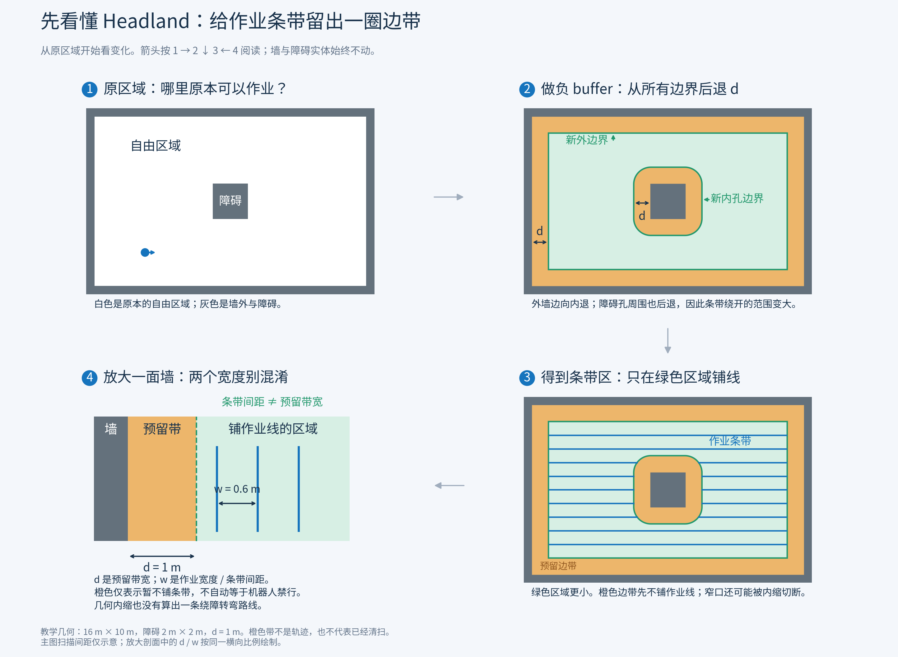
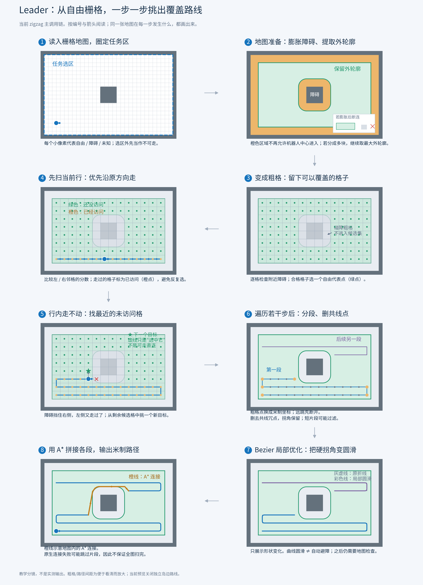
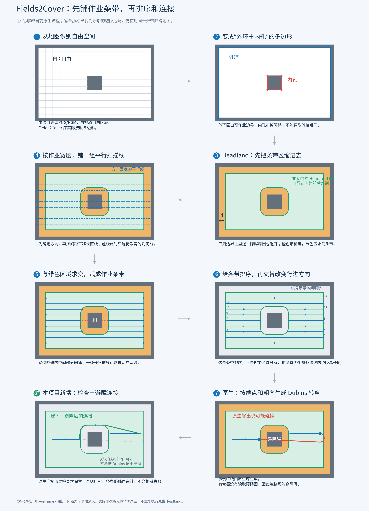

# 从地图到路线：Leader 与 Fields2Cover 形象分镜

2026-10-29。每一步都画出同一张示例地图的变化，按编号和灰箭头阅读；不是只有名称的流程框。

**这是教学示意，不是 benchmark 实测轨迹。** 示例为16 m × 10 m区域和2 m × 2 m障碍；粗格/扫描间距为可读性放大。Leader当前zigzag主调用链、Fields2Cover原生流水线和本项目新增适配分开标注。原算法和实测记录未改。

## 先看懂 Headland



[可放大SVG](01_headland_explained.svg)

- 灰色墙和障碍实体不动。
- 从原自由多边形的所有边界向内退 `d`：外环缩小，内孔向周围扩展。
- 橙色是原自由区中先留出的边带；绿色才是本步骤得到的条带生成区域。
- `d` 是预留带宽，`w` 是作业宽度/扫描间距，两者不是同一个参数。放大剖面按同一横向比例画出 `d=1m` 和 `w=0.6m`，主图扫描间距仅示意。
- Headland 橙色带表示暂不铺条带，不自动等于机器人禁行；可以为后续转弯留空间，但不保证能安全转弯。Leader图中的橙色则表示膨胀后机器人中心不可进入的格子，两者不能混同。
- Headland 内缩不是自动的避障转弯规划，也没有自动清扫橙色带。即使边带留出来，之后生成的连接仍需检查。

本图绿色多边形由实际 GDAL/OGR `Buffer(-1)` 计算，包括障碍孔的圆角偏置，并非手画一个粗略外接矩形。

## Leader：先变粗格，再逐步选下一格



[可放大SVG](02_leader_storyboard.svg)

图中依次展示：输入栅格/选区 → 膨胀及外轮廓 → 粗格代表点 → 行内延续 → 受阻选择剩余目标 → 米制坐标/分段/删共线点 → 局部Bezier → A*连接。

绿色点是尚未访问的候选粗格，橙点是已访问；第五步虚线仅表示选择了新目标，不能理解为机器人穿过去。第六步展示的是继续遍历后的示意片段，第七步仅展示圆滑形状，第八步的橙线表示地图连接。当前原生合并函数遇到连接失败可能跳过片段，因此图中没有承诺完整覆盖。当前预览未启用独立岛边路线。

Leader 的膨胀/粗格示意用于解释操作对象，不声称栅格近似距离与连续多边形负buffer完全等价；示意曲线和连接不是原CPP在这个教学图上的实测返回。

## Fields2Cover：先生成全部条带，再排序与连接



[可放大SVG](03_fields2cover_storyboard.svg)

①–⑦为原生流水线：地图输入适配 → 外环/内孔 → Headland → 平行扫描线 → 求交得到条带 → 排序与交替方向 → 原生Dubins连接。

第⑧步用绿色单独标出本项目自有避障模块，不把它冒称为原生库的功能。实际修改版先选择精确净空下的起点可达分量，再生成条带，关闭额外Headland，避免重复内缩；然后做条带裁剪、检查后保留原生转弯或使用A*，最后审计整路。

第⑦步红线来自当前固定 Fields2Cover 库真实生成的一条教学 Dubins 连接，而不是任意画一条穿障曲线。输入端点/朝向、采样CSV和穿原障碍内部的点数保存在 [geometry_evidence.json](geometry_evidence.json)；绿色避障连接由公共栅格连接器在教学净空图上计算。此例不是实测benchmark，不发机器人任务；绿色折线不承诺Dubins最小半径或连续曲率。

## 每一步对应的源码

| 图中操作 | 当前源码/函数 |
| --- | --- |
| Leader选区外屏蔽、规划入口 | [adapter.cpp](../../../leader_coverage_ws/src/bg1_leader_coverage/src/adapter.cpp)：`leader_preview::plan` |
| Leader膨胀、最大外轮廓 | [task_helper.cpp](../../../third_party/leader/coverage_path_planner/src/task_helper.cpp)：`getTasMatAndBoudPath`、`inflateCostMat`、`findBoudPath` |
| Leader粗格筛选/代表点 | [FreeSpaceCalculator.cpp](../../../third_party/leader/coverage_path_planner/src/FreeSpaceCalculator.cpp)：`get_free_cell_in_polygon_final` |
| Leader遍历、分段、Bezier、A*拼接 | [CoveragePathPlanner.cpp](../../../third_party/leader/coverage_path_planner/src/CoveragePathPlanner.cpp)：`get_zigzag_indexed_path`、`get_coverage_paths`、`get_merged_path` |
| F2C几何内缩 | [constant_headland.cpp](../../../third_party/Fields2Cover/src/fields2cover/headland_generator/constant_headland.cpp)：`field.Buffer(-dist_headland)` |
| F2C扫描线生成及区域求交 | [swath_generator_base_impl.hpp](../../../third_party/Fields2Cover/include/fields2cover/swath_generator/swath_generator_base_impl.hpp)：`generateSwaths` |
| F2C排序/交替方向 | [single_cell_swaths_order_base.cpp](../../../third_party/Fields2Cover/src/fields2cover/route_planning/single_cell_swaths_order_base.cpp)：`genSortedSwaths` |
| F2C原生转弯连接 | [path_planning.cpp](../../../third_party/Fields2Cover/src/fields2cover/path_planning/path_planning.cpp)：`searchBestPath` |
| 自有避障层 | [obstacle_connector.py](../../../coverage_benchmark/obstacle_connector.py)、[grid_connector.py](../../../coverage_benchmark/grid_connector.py) |

## 生成与复核

确定性绘图源码：[render.py](render.py)。需要项目既有 numpy/scipy/matplotlib、GDAL共享库和Noto中文字体；SVG可编辑，PNG用于直接查看。

```bash
python3 docs/diagrams/coverage_logic_2026-10-29/render.py
```

原生示例连接的输入源码：[dubins_example.cpp](dubins_example.cpp)，原始采样：[dubins_example.csv](dubins_example.csv)。重新生成CSV需要项目已构建的Fields2Cover库；先加载Jazzy及coverage overlay以提供动态库路径，再编译运行：

```bash
source /opt/ros/jazzy/setup.bash
source coverage_ws/install/setup.bash
g++ -std=c++17 -O2 docs/diagrams/coverage_logic_2026-10-29/dubins_example.cpp \
  -Icoverage_ws/install/fields2cover/include -I/usr/include/gdal \
  -Lcoverage_ws/install/fields2cover/lib -lFields2Cover -lgdal \
  -o /tmp/bg1_dubins_teaching
/tmp/bg1_dubins_teaching docs/diagrams/coverage_logic_2026-10-29/dubins_example.csv
python3 docs/diagrams/coverage_logic_2026-10-29/render.py
```

生成器核对红线确实穿过原障碍内部、绿色A*连接通过教学净空栅格，并保存示例参数/源码/采样指纹。Headland偏置边界、SVG/PNG及中文/箭头布局另作检查。未启动ROS规划服务、Gazebo或机器人运动。
