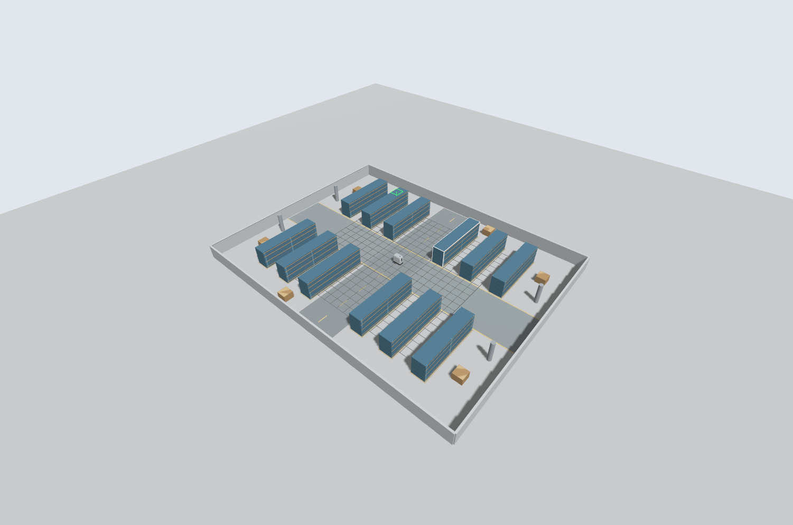
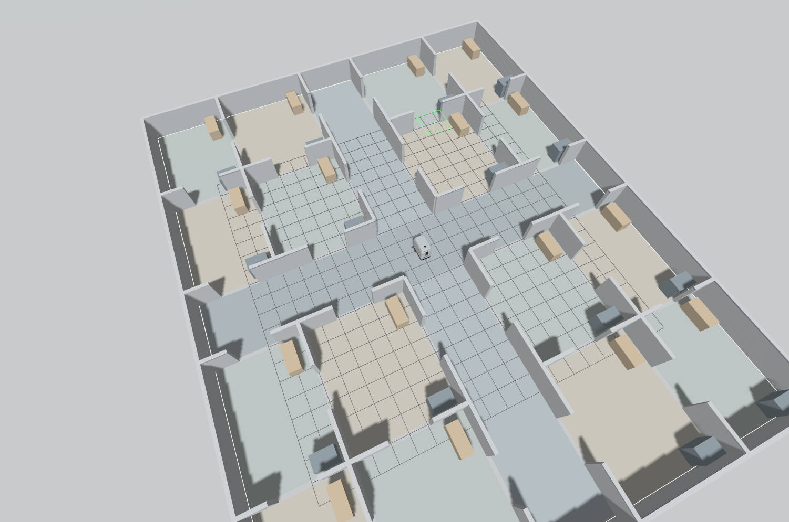

# BG1 大场景

独立的 `bg1_scenarios` 资源包，使用参数化布局同时生成 Gazebo 世界和匹配的 5 cm 参考地图。默认 `demo` 保留原场景。

| scene | 尺寸 | 布局 |
| --- | --- | --- |
| `warehouse` | 36 × 28 m | 12 组货架、6 组托盘、4 根柱，主交叉通道 6 m、货架间距 2.4 m |
| `office` | 32 × 26 m | 16 间互通房间，中央十字走廊宽 4 m、门宽 2.2 m，每间配桌柜 |

两个场景都在中央 `(0, 0, 0)` 出生。障碍物具有碰撞体，激光可以检测；地面分区和标线仅作视觉显示。




从仓库根目录运行，每次只启动一个仿真：

```bash
# 建图：Gazebo + RViz + SLAM Toolbox + 键盘终端
bash ros_ws/mapping.sh scene:=warehouse
bash ros_ws/mapping.sh scene:=office

# 使用随场景生成的参考地图导航：Gazebo + RViz + Nav2
bash ros_ws/navigation_demo.sh scene:=warehouse
bash ros_ws/navigation_demo.sh scene:=office
```

建图模式不加载参考地图，需要自己遥控探索。键盘终端 `i` 前进、`,` 后退、`j/l` 转弯、`k` 停车。保存和退出：

```bash
bash ros_ws/save_map.sh
bash ros_ws/stop_mapping.sh
```

导航模式可用 RViz 的 **Nav2 Goal** 点选目标。办公区通过独立的 `config/office_navigation.yaml` 将 NavFn 改为 Dijkstra：本机 Jazzy 的 A* 模式在一个房间入口出现势场提取路径失败，Dijkstra 可通过全部 20 个规划探针。原始 `nav2.yaml`、RPP 控制器和其他场景的规划参数不变。

修改 `config/warehouse.yaml`、`config/office.yaml` 后，从源码重新生成世界、地图、布局元数据和俯视预览：

```bash
python3 ros_ws/src/bg1_scenarios/tools/build_scenes.py
```

生成器是源码开发工具，不作为 `ros2 run` 可执行文件安装。修改后按工作区说明重新构建。`maps/` 为已知布局生成的参考地图；自己的 SLAM 地图保存在 `data/maps/slam/`，二者分别管理。

覆盖演示仍使用原来的独立空矩形区域；这些复杂场景尚未接入障碍物感知的全覆盖规划。

验证记录位于 `ros_ws/docs/verification/scenes/`。导航检查只验证地图、传感器、TF 与目标路径生成，不代表机器人已实际行驶完所有路线。
